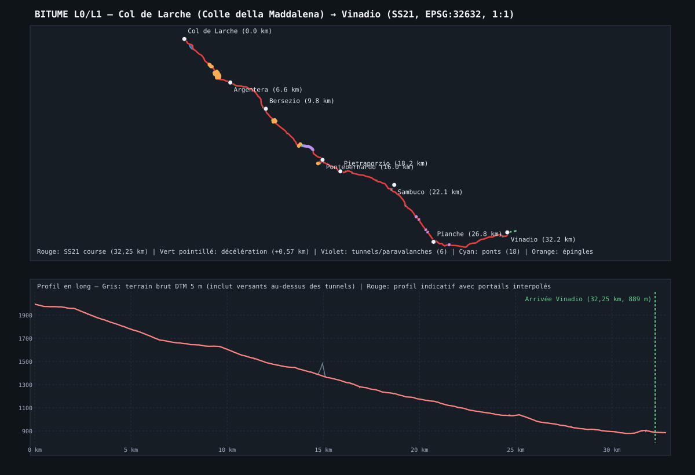

# Col de Larche (Colle della Maddalena) → Vinadio — Sources & Reconstruction L0/L1 (2026)

**Périmètre retenu (correction David du 21 novembre 2026) :** départ au **sommet du col de Larche**
(Colle della Maddalena, nœud OSM `928715494`), descente intégrale en **échelle 1:1** par la **SS21**
jusqu’à **Vinadio** (nœud OSM `4295216268`), sans montée française depuis Barcelonnette et sans fermeture
artificielle. **Identifiant réservé : `larche` (`topologie: "ouvert"`, `pretPourRuntime: false`).**

Ce paquet L0/L1 fige les sources primaires réelles, leur provenance, leurs licences, leurs inconnus, la
reconstruction métrique `EPSG:32632` et la vue de contrôle plan + profil en long. Il ne modifie aucun
des 9 circuits existants ni le build courant du jeu.

## Reproduire et contrôler hors ligne

```sh
python3 tools/preparer-larche-vinadio.py
python3 tools/preparer-larche-vinadio.py --check
node --test verifications/larche-vinadio-sources.test.mjs
```

## Mesures L1 issues des sources figées

| Grandeur | Mesure | Remarque / provenance |
|---|---|---|
| Départ proposé | `44.421833°N, 6.898427°E` — **`1 992,97 m`** | Nœud OSM `928715494` (frontière FR/IT, col de Larche) + DTM 5 m Regione Piemonte |
| Arrivée proposée | `44.308515°N, 7.177170°E` — **`889,46 m`** | Nœud OSM `4295216268` (sortie Via Roma / Vinadio centre, sans traverser le fort Albertino) |
| Zone de décélération | `+567,48 m` (`32,249 → 32,817 km`) | Nœud OSM `452592466` sur la SS21 droite à l’est de Vinadio |
| Longueur en plan (course) | **`32 249,33 m`** (`32,249 km`) | Sans remise à l’échelle ; écart `+0,049 km` vs repère Ubaye Tourisme (`32,2 km`) |
| Longueur 3D indicative (course) | **`32 284,34 m`** | Avec portails d’ouvrages interpolés linéairement |
| Dénivelé net / D+ / D− | **`−1 103,51 m`** (`+62,9 m` / `−1 166,5 m`) | Pente moyenne `−3,42 %` |
| Chaîne OSM SS21 | **1 composante**, `84` voies, `1 042` points (`1 031` course) | Aucun trou, aucune bifurcation, 0 voie française `D 900` incluse |
| Ouvrages taggés OSM | **6 tunnels / paravalanches**, **16 ponts** | `yChausseeM = null` sur tous les ouvrages (le LiDAR voit jusqu’à `+73 m` de versant sur le tunnel de 820 m) |
| Épingles détectées | **21 épingles** (`Δcap >= 115°` sur `<= 160 m`) | Conservées à leur rayon réel |
| Contrôle inter-datum frontière | **25 points** (`s = 0..626 m`) | Écart moyen Piemonte DTM 5 m − IGN RGE ALTI = **`+0,023 m`** (max abs `0,727 m`) |
| Anomalies pente terrain hors ouvrage | **2 segments** (`|pente| > 14 %`) | Consignés dans `trace-l1.json` (`anomaliesPenteTerrain`) pour examen L3 |

## Repères vérifiés le long de la SS21

- **Col de Larche / Colle della Maddalena** : `0,000 km` (`1 992,97 m`), lac de la Maddalena (`way 39680583`)
- **Argentera** : `6,553 km`
- **Bersezio** : `9,845 km`
- **Pontebernardo** : `16,043 km`
- **Pietraporzio** : `18,207 km`
- **Sambuco** : `22,089 km`
- **Pianche** : `26,754 km`
- **Vinadio** : `32,249 km` (`889,46 m`)

## Fichiers et licences

| Fichier | Rôle |
|---|---|
| `sources/osm-ss21-corridor.json` | Instantané Overpass OSM de la SS21, des lieux-dits et du lac (`© OpenStreetMap contributors`, **ODbL 1.0**) |
| `sources/piemonte-dtm5-samples.json` | Échantillons LiDAR natifs 5 m sur les `1 051` nœuds + coupes `±15 m / ±40 m` + grille vallée `100 m` (`260 × 180`), issus de 10 bandes WCS `EPSG:32632` (**Regione Piemonte — ICE 2009–2011 DTM 5, CC BY 4.0**) |
| `sources/piemonte-dtm5-metadata.xml` & `piemonte-dtm5-describecoverage.xml` | Fiche GeoNetwork `r_piemon:224de2ac-023e-441c-9ae0-ea493b217a8e` (19/02/2026) et `DescribeCoverage` WCS 1.0.0 |
| `sources/worldcover-2021.json` | Occupation du sol ESA à 200 m sur l’emprise du MNT. Trois fractions U8 par cellule, grille de 130 × 90, attribution et licence incluses. |
| `sources/ign-rge-alti-frontiere.json` | 25 sondages frontaliers IGN RGE ALTI (**IGN — Licence Ouverte 2.0**) |
| `manifest.json` | Provenance complète, empreintes SHA-256 des sources figées et des 10 bandes WCS brutes, CRS et extrémités |
| `inconnus.json` | Registre explicite des mesures absentes (`width`, dévers, radiers de tunnels, tabliers de ponts, ancienneté LiDAR 2009–2011) |
| `trace-l1.json` | Polyligne métrique ordonnée (`EPSG:32632` et repère local jeu), ouvrages, épingles et repères |
| `plan-et-profil.svg` | Carte 2D UTM 32N et profil altimétrique de contrôle |



## Couverture des versants lointains

Zanaga et al. (2022), *ESA WorldCover 10 m 2021 v200*. © ESA WorldCover project 2021 / Contains modified Copernicus Sentinel data (2021) processed by ESA WorldCover consortium. [Jeu de données](https://doi.org/10.5281/zenodo.7254221) · [Données et attribution](https://esa-worldcover.org/en/data-access) · [Licence CC BY 4.0](https://creativecommons.org/licenses/by/4.0/)

L’archive locale contient des moyennes de surface arrondies sur 255. Les classes 10, 30 et 60 décrivent respectivement les arbres, les prairies et les sols nus ou à végétation clairsemée. Les huit autres classes conservent leur part dans chaque cellule et reçoivent une couleur neutre. L’acquisition 2021 décrit l’occupation du sol. Les teintes d’été et d’hiver sont des choix de rendu. [Tuile catégorielle N42E006](https://esa-worldcover.s3.eu-central-1.amazonaws.com/v200/2021/map/ESA_WorldCover_10m_2021_v200_N42E006_Map.tif)

Depuis la racine du dépôt, `python3 tools/generer-larche-runtime.py` reproduit le module du jeu hors ligne à partir des archives. Le générateur filtre les proportions dans les deux axes avant leur interpolation aux sommets du MNT. Pour refaire aussi les mesures depuis la tuile originale, employer Python 3.11 ou ultérieur avec rasterio et NumPy puis exécuter `python3 tools/echantillonner-larche-worldcover.py <tuile.tif>`. L’outil vérifie le SHA-256 du GeoTIFF et agrège les indicatrices de classes par moyenne de surface en EPSG:32632. Le jeu lit les valeurs embarquées.
