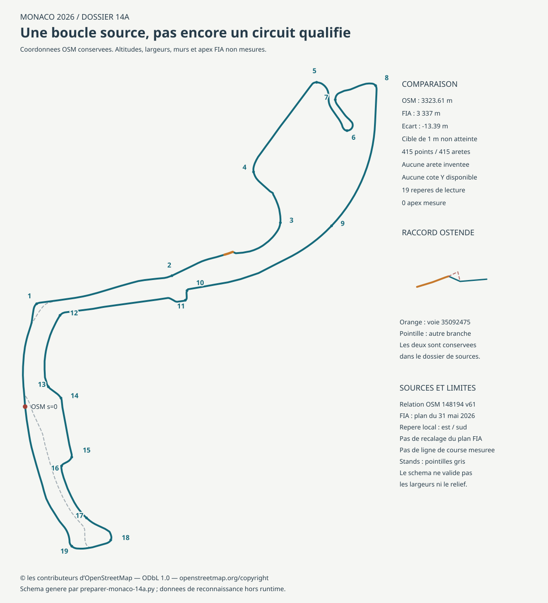

# Monaco 2026 — sources métriques, préparation 14A

**La topologie OSM est résolue ; la fidélité métrique du circuit n'est pas encore qualifiée.**
Le dossier fournit une boucle de reconnaissance de **3 323,610 m**, composée de **415 points et
415 arêtes OSM**, sur 41 voies sélectionnées. Aucun segment n'est inventé, aucun nœud géographique
n'est déplacé et aucune mise à l'échelle ne force la longueur officielle de **3 337 m**.
Les 19 virages ont des repères de reconnaissance ordonnés ; les apex FIA restent à mesurer.

Ce lot ne charge aucune donnée dans le jeu, n'ajoute aucun circuit jouable et ne modifie ni la version,
ni le build, ni les huit circuits existants. Il prépare les entrées d'un futur tracé explicite ; les valeurs
`y`, `leftWidthM`, `rightWidthM` et `bankRadians` sont **null**, pas zéro ou des valeurs par défaut.

## Reproduire et lire le dossier

Depuis la racine du dépôt :

```sh
python3 tools/preparer-monaco-14a.py
python3 tools/preparer-monaco-14a.py --check
node --test verifications/monaco-sources.test.mjs
```

La préparation utilise uniquement Python standard et les instantanés enregistrés. Aucun appel réseau,
service de tuiles, moteur de jeu ou bibliothèque SIG n'est nécessaire. `--check` compare les trois
sorties attendues sans écrire. Une empreinte source différente fait échouer la préparation.

| Fichier | Rôle |
|---|---|
| `sources.json` et `sources/` | URLs, droits, empreintes et versions ; trois instantanés OSM conservés à l'identique. |
| `topologie.json` | Décisions explicites : voies des stands, raccord et branche écartée. |
| `reperes.json` | Faits FIA/F1, numéros et noms, rattachements de reconnaissance et mesures manquantes. |
| `donnees.json` | Points locaux, arêtes ordonnées avec provenance, voies auxiliaires et tags de tunnel. |
| `comparaison.json` | Longueurs, écarts, complétude et réserves calculées. |
| `plan.svg` | Vue de contrôle générée depuis les coordonnées, avec le détail du raccord. |

La liste `points` ne répète pas le premier point. La dernière entrée `edges` ferme la boucle sur ce
premier point par une arête présente dans OSM. `sM` part du nœud OSM 4937755860 ; ce marqueur de
départ/arrivée **n'a pas été identifié à l'une des deux lignes distinctes du plan FIA**. Les voies des
stands sont conservées séparément, sans prétendre qualifier leurs raccords de course.



## Raccord Ostende / Monte-Carlo

La relation 148194 v61 comporte 43 membres : un marqueur et 42 voies. Les membres ne sont pas
ordonnés pour former un tour simple. La voie 850261588 a le rôle `pit_lane`. La voie 1388331347 est
nommée « Sortie des stands », mais possède un rôle vide : elle doublait la portion Sainte-Dévote et
créait deux bifurcations. Ces deux voies sont classées comme auxiliaires, sans suppression des sources.

Le raccord manquant utilise exclusivement une sous-chaîne de la voie **35092475**, avenue Princesse
Alice, présente dans l'extrait de zone :

`918118157 → 14109303021 → 1737326309 → 12571844664`

Cette sous-chaîne mesure **18,270 m** dans le repère local WGS84. Elle rejoint la voie 1551240830,
puis la partie `14109303023 → 21912962` de la voie 1551240829. Le préfixe
`14109303022 → 14109303023` de cette dernière est une branche de voirie de **5,395 m**, écartée
du tour principal. Les versions 1 et 2 de cette voie contiennent déjà la même séquence de nœuds ;
le dossier n'attribue pas ce défaut de topologie à une modification récente de géométrie.

La sélection conserve la voie 1551240830, membre du circuit, et utilise le raccord de voirie nécessaire
pour la rejoindre. L'autre chemin réel via 14109303022 est aussi enregistré dans `topologie.json` et
contrôlé comme boucle : **3 327,698 m**, soit 4,088 m de plus. Il n'est pas choisi parce qu'il
s'approche davantage de 3 337 m. Les sources disponibles ne mesurent pas la position des limites de
course dans cette intersection ; le choix fin de la ligne centrale reste à confronter à un relevé adapté.

Chaque arête résultante indique l'identifiant et la version de sa voie OSM, son index dans la séquence
originale, son sens et ses nœuds exacts. La préparation refuse un nœud de degré différent de deux,
une arête sans provenance, une composante séparée ou un cycle prématuré. Aucun déplacement,
interpolation entre voies disjointes, lissage ou correction répartie de fermeture n'est appliqué.

## Mesure de longueur et comparaison officielle

Les coordonnées WGS84 sont converties en ECEF sur l'ellipsoïde, puis projetées sur le plan tangent
local centré au marqueur OSM : **x vers l'est, z vers le sud, y inconnu**. L'altitude ellipsoïdale
zéro employée dans cette conversion est une convention mathématique de projection ; elle ne fournit
aucune altitude de chaussée. Les coordonnées exportées sont arrondies au millimètre pour la
reproductibilité numérique, sans revendiquer cette précision sur le terrain.

| Contrôle | Résultat |
|---|---:|
| Somme des membres principaux avant résolution, non fermée | 3 310,734 m |
| Raccord réel ajouté | +18,270 m |
| Branche urbaine retirée du tour | −5,395 m |
| Boucle OSM projetée | **3 323,610 m** |
| Référence FIA/F1, ligne centrale | **3 337 m** |
| Écart OSM − FIA | **−13,390 m, soit −0,401 %** |
| Cible du plan maître : écart absolu ≤ 1 m | **Non atteinte** |
| Secteurs FIA | 1 051 + 1 419 + 867 = **3 337 m** |

La somme initiale d'environ 3 307,937 m du premier dossier utilisait une distance sphérique.
La valeur 3 310,734 m ci-dessus emploie la projection WGS84 de ce lot : il ne s'agit pas du même
calcul. La source OSM représente des axes de voirie et des portions de circuit, sans profil altimétrique.
Le plan FIA annonce une ligne centrale de course. L'écart calculé ne permet pas à lui seul d'imputer
13,390 m à une portion précise, ni de déduire un facteur de correction fiable.

## Les 19 virages

Le [guide F1 2026][f1-guide] confirme 3,337 km et 19 virages. La page 2 du [document FIA][fia]
numérote T1 à T19 et fournit les secteurs. Les [rubriques F1 sur les noms][f1-names] associent les
noms suivants à cette séquence. Leur introduction mentionne 18 virages, alors que les rubriques vont
jusqu'à T19 : le total retenu vient du plan FIA et du guide, pas de cette phrase contradictoire.

| Virages | Noms de référence | Sens lus sur le plan |
|---|---|---|
| 1 / 2 / 3 / 4 | Sainte-Dévote / Beau Rivage / Massenet / Casino | droite / gauche / gauche / droite |
| 5 / 6 / 7 / 8 | Mirabeau Haut / épingle Fairmont / Mirabeau Bas / Portier | droite / gauche / droite / droite |
| 9 / 10 / 11 / 12 | Tunnel / Nouvelle Chicane entrée et sortie / Tabac | droite / gauche / droite / gauche |
| 13 / 14 / 15 / 16 | Les deux enchaînements de la Piscine | gauche / droite / droite / gauche |
| 17 / 18 / 19 | Courbe sans nom / La Rascasse / Antony Noghès | gauche / droite / droite |

Les 19 intervalles de reconnaissance parcourent les points OSM dans cet ordre, et leur rotation signée
correspond au sens attendu. **Ce contrôle ne mesure pas les 19 apex officiels.** Les positions des
repères sont candidates, leur précision horizontale est inconnue, et les microchangements de direction
des rues ne sont pas comptés comme de nouveaux virages FIA. Les distances officielles S1 à 60 m
avant T5 et S2 à 70 m avant T13 restent des références ; elles ne sont pas projetées arbitrairement sur
le parcours OSM pour fabriquer des lignes de secteur.

## Altitudes, largeurs, tunnel et stands

- Les 415 altitudes de chaussée, les 415 largeurs gauches, les 415 largeurs droites et tous les dévers restent absents.
  Aucun tag `ele` n'existe sur ces nœuds, ni tag `width`/`width:lanes` sur les voies sélectionnées.
  Un nombre de voies de circulation n'est pas converti en largeur de piste.
- Deux ensembles distincts portent le tag OSM `tunnel=yes`. Ils sont conservés avec leurs identifiants
  et extrémités, sans déduire une altitude, une hauteur libre ou fusionner un espace non tagué entre eux.
- Les deux voies auxiliaires ont des nœuds communs avec le parcours principal. Cela ne qualifie ni les
  limites de course, ni les rails, ni les accès aux emplacements. La page 3 FIA reste la référence des stands.
- Le service SIGM de topographie signalé comme restreint dans le dossier initial est exclu. Aucune cote,
  image ou géométrie de ce service n'a été reprise.
- La politique saisonnière Monaco reste à préciser avant l'intégration jouable. Ce dossier n'ajoute aucune
  exception au comportement actuel des modes Manuel/Aléatoire/Réel ou des conditions choisies par l'hôte.

La suite doit acquérir des altitudes de chaussée, des limites et largeurs de course exploitables, vérifier
les lignes FIA et les portails, puis confronter les repères depuis des vues de piste. Les champs manquants
doivent empêcher une ingestion silencieuse par `creerDepuisTrace` ; aucun remplacement par `0` ou
une largeur commune n'est fourni ici. **Le lot 14A complet du plan maître n'est pas déclaré clos.**

## Provenance, dates et attribution

Les fichiers XML OSM sont conservés octet pour octet avec leurs identifiants, versions et dates.
La relation est en version 61, datée du 21 août 2026 ; ses membres portent leurs propres versions,
dont certaines vont jusqu'au 9 novembre 2026. Ce n'est pas un instantané géographique du jour de course.
Les dates exactes des deux acquisitions initiales n'ont pas été consignées : elles restent inconnues.
L'URL de répétition de la petite zone provient des limites `bounds` du XML, sans être présentée comme
l'URL historiquement enregistrée. Une nouvelle acquisition pourrait différer ; la reproduction utilise
les fichiers vérifiés, jamais la réponse actuelle d'une API.

**© les contributeurs d'OpenStreetMap.** Les données OSM, leur sélection ordonnée, les coordonnées
dérivées et la carte de contrôle sont distribuées sous [ODbL 1.0][odbl]. L'[attribution OSM][osm-rights]
doit rester visible lors d'une réutilisation, et la licence des données doit rester indiquée. Le code de
préparation suit les conditions du dépôt ; il ne modifie pas la licence des données.

Le document FIA est une référence protégée, pas une source de textures ou de coordonnées géographiques.
Le dépôt conserve ses faits utiles, son URL, son numéro, ses dates et l'empreinte SHA-256 de l'exemplaire
examiné. Son plan et les photographies F1 ne sont pas copiés dans les données ni embarqués dans le jeu.

[fia]: https://www.fia.com/system/files/decision-document/2026_monaco_grand_prix_-_competition_notes_-_circuit_map_pit_lane_drawing_emergency_exits_map_and_red_zone.pdf
[f1-guide]: https://www.formula1.com/en/latest/article/circuit-guide-everything-you-need-to-know-about-the-circuit-de-monaco.vFsmfGHr6RWyLFtxi58wi
[f1-names]: https://www.formula1.com/en/latest/article/explained-how-every-monaco-corner-got-its-name.5ClYqWmfpeUpsRJA6mDNaX
[odbl]: https://opendatacommons.org/licenses/odbl/1-0/
[osm-rights]: https://www.openstreetmap.org/copyright


## Relevé de terrain et registre de mesures — 20 novembre 2026

Un complément prépare maintenant les mesures sans modifier cette reconnaissance OSM :

| Fichier | Rôle |
|---|---|
| `sources-mesures.json` | Cinq acquisitions IGN figées, requêtes, licences, dates, empreintes et références FIA supplémentaires. |
| `sources/mesures-20261120/` | Réponses LiDAR et RGE ALTI sur les 415 points, descriptifs et métadonnées des dalles. |
| `mesures-terrain.json` | Observations des deux produits, rattachements aux dalles, passages couverts et écarts à examiner. |
| `mesures-controlees.json` | Registre annoté : provenance, date, datum, incertitude et éligibilité d'une observation. |
| `bilan-mesures.json` | Couverture, points manquants et divergences ; aucune qualification automatique du profil routier. |

```sh
python3 tools/preparer-monaco-mesures.py
python3 tools/preparer-monaco-mesures.py --check
node --test verifications/monaco-mesures.test.mjs verifications/monaco-altimetrie.test.mjs
```

Ces commandes utilisent uniquement les sources enregistrées. Le registre distingue les altitudes
de terrain des altitudes de chaussée ; les premières restent non éligibles au profil routier.
L'import refuse les valeurs invalides, identifiants inconnus et unités incohérentes ; il préserve
les incertitudes et dates inconnues ainsi que les contradictions. Une cote sous tunnel ne se
déduit pas de la surface du MNT. La résolution de 50 cm n'est pas une précision individuelle.

Le rattachement aux métadonnées LiDAR documente IGN69 et les dates de relevé disponibles en 2021,
distinctes de l'acquisition HTTP en 2026. La largeur de référence FIA isolée ne devient pas une
largeur constante de circuit. Les fichiers historiques `donnees.json`, `comparaison.json` et
`plan.svg`, leurs champs `null` et la longueur de reconnaissance restent inchangés.

Fiche complète : [Monaco — mesures traçables](../../reprise/MONACO-MESURES-2026-11-20.md).

## Revue exhaustive et prochaine source routière

La [revue localisée](revue-mesures.md) couvre tous les 32 écarts >1 m, les 33 points tunnel
et les 17 alertes de pente : 49 points distincts avec provenance, repères et inconnues.
`tools/examiner-monaco-mesures.py --check` vérifie sa reproduction hors réseau.
Les [35 contrôles ciblés](qualification-revue.json) passent ; aucune nouvelle cote routière n'est qualifiée.
Une [sonde IGN BD TOPO](PISTE-BDTOPO.md) de sept objets donne une piste de données 3D
sur Louis-II, avec deux voies souterraines à distinguer. Le tracé OSM et les registres
historiques restent inchangés ; le lot 14A reste ouvert.

## Carte, profils et provenance temporelle

Le [complément cartographique](revue-chaussee.svg) situe les sept groupes des 32 écarts,
les 17 arêtes de pente terrain à relire, les deux ensembles de tunnel et leurs quatre
extrémités candidates. Le [registre de revue](revue-chaussee.json) conserve les indices,
les sources et les inconnues ; il complète `revue-mesures.json/.md` sans les remplacer.

```sh
python3 tools/preparer-monaco-revue.py
python3 tools/preparer-monaco-revue.py --check
node --test verifications/monaco-revue-cartographie.test.mjs
```

Le générateur reconstruit les entrées OSM et IGN depuis les instantanés et contrôle
18 fichiers historiques. Les [8 nouveaux contrôles et la CI complète de 145 suites](qualification-revue-cartographie.json)
sont réussis ; publication par [PR #29](https://github.com/M4D135/bitume/pull/29).

La [revue des sources primaires](REVUE-SOURCES-20261120.md) précise les périodes
des deux dalles effectivement utilisées et la portée des métadonnées IGN. Une période
ou une date de dalle ne certifie pas la date individuelle d'une cellule MNT ; cette dernière
reste inconnue. Les deux accès COPC bornés ont renvoyé 403, sans cause établie ni nuage acquis.

La prochaine acquisition utile reste la [source routière BD TOPO](PISTE-BDTOPO.md) :
confronter niveaux, topologie et ruptures, établir datums et dates, puis compléter les
limites de course. Aucune interpolation de ligne 3D candidate ne qualifie automatiquement
la chaussée. Les champs routiers restent `null`, `readyForRuntime=false`, Monaco non jouable.

Fiche : [publication du complément cartographique](../../reprise/MONACO-CARTE-REVUE-2026-11-20.md).
