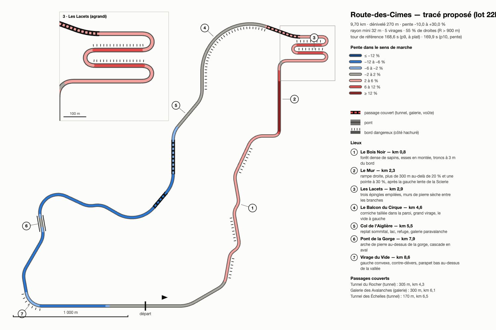
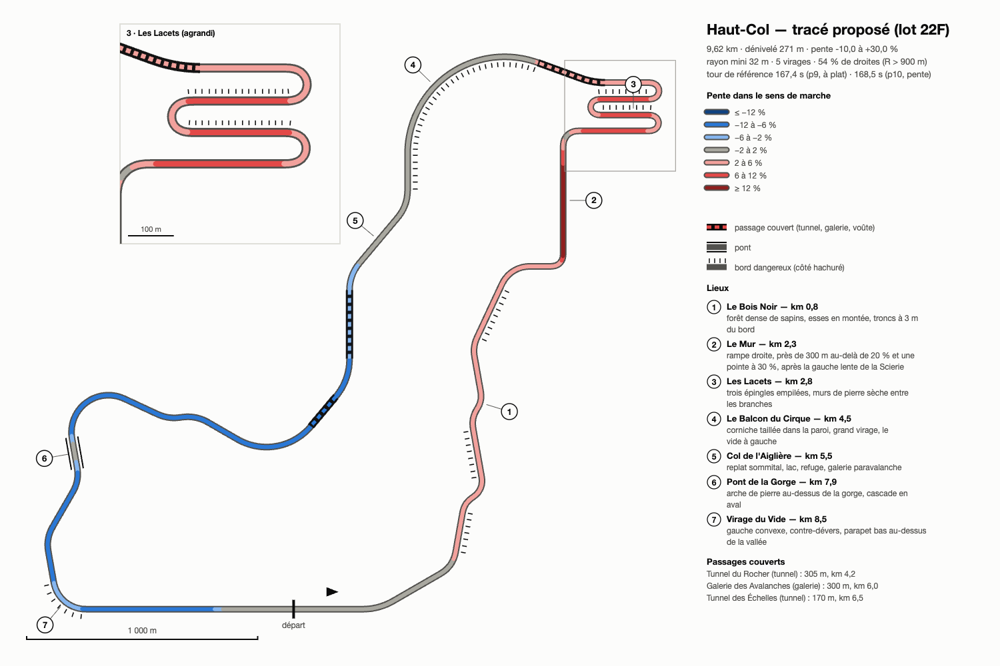
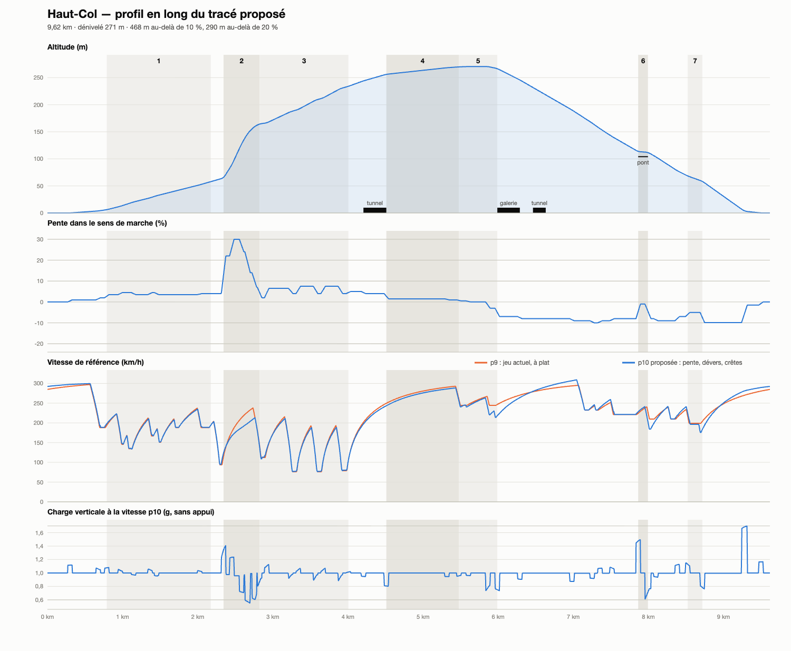
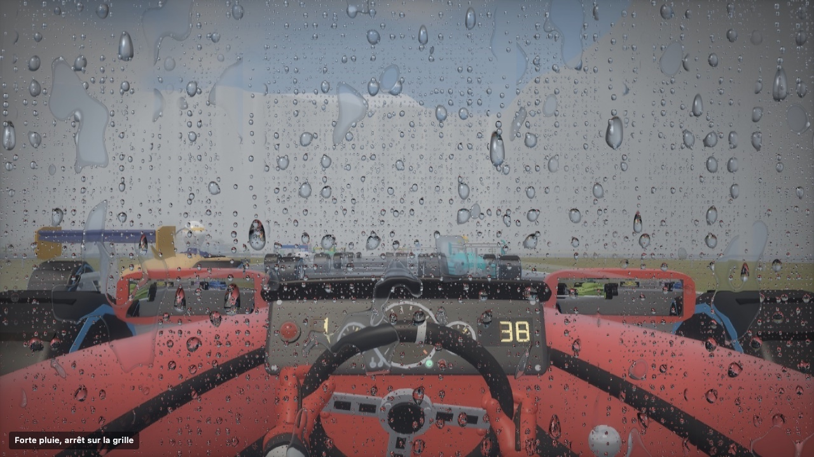
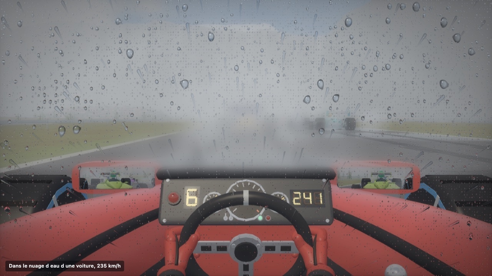
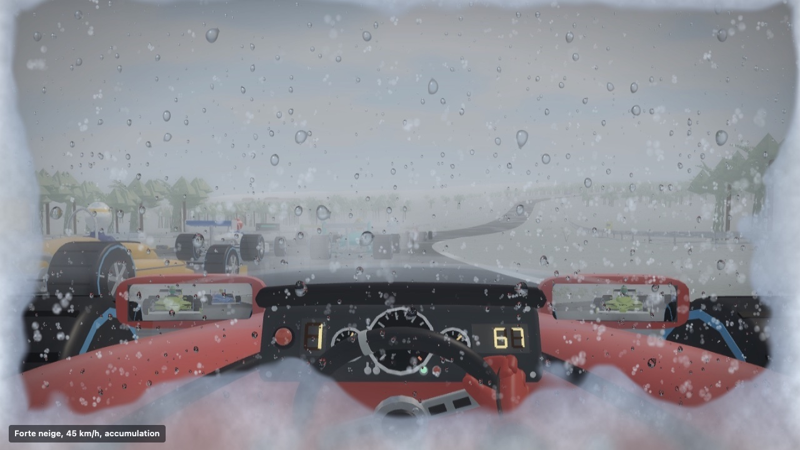

# Références et objectifs de David — 20 novembre 2026

Les six fichiers sont les originaux joints par David à sa demande de continuation autonome.
Ils servent de modèles visuels et de conception. Ce ne sont pas des preuves de la qualité
du jeu publié. Le manifeste conserve noms d'origine, dimensions, tailles et SHA-256.
Ces images restent dans la documentation : le jeu produit ses formes et effets par le code.

## Montagne : deux circuits distincts

| Fichier | Rôle | Objectif et limite |
|---|---|---|
| [route-des-cimes-plan.png](route-des-cimes-plan.png) | Plan final demandé | Nouveau circuit d'environ 9,70 km, dénivelé 270 m, Mur culminant à 30 %, trois passages couverts et pont. Ne remplace pas Haut-Col. |
| [haut-col-etude-historique.png](haut-col-etude-historique.png) | Étude antérieure du grand circuit | 9,62 km et 271 m ; son titre historique ne change pas l'identité du Haut-Col existant. |
| [profil-montagne-historique.png](profil-montagne-historique.png) | Profil et simulations historiques | Pentes, altitude et sections caractéristiques. Les courbes p9/p10 sont des études, pas une qualification p15. |

Lieux à conserver : Bois Noir, Mur, Lacets, Balcon du Cirque, Col de l'Aiglière,
Pont de la Gorge et Virage du Vide. Trois passages : tunnel du Rocher (305 m),
galerie des Avalanches (300 m), tunnel des Échelles (170 m). Les positions arrondies
du dessin sont des objectifs ; les données finales et écarts mesurés seront consignés.

Les séquences métriques de l'étude ont été retrouvées dans `tools/lieux-partitions.mjs`.
Les anciens objets Git du plan final n'ont pas été retrouvés dans l'inventaire effectué.
Tout ajustement nouveau sera nommé reconstruction depuis l'étude et les références,
avec comparaison chiffrée ; il ne sera pas présenté comme un original récupéré.

Étude et profil historiques

## Météo : matière, mouvement et visibilité

| Fichier | Scène cible | Critères de réalisation |
|---|---|---|
| [pluie-grille.jpeg](pluie-grille.jpeg) | Forte pluie, arrêt sur la grille | Microgouttes nombreuses, tailles variées, gouttes épaisses, fusion, ruissellement et réfraction ; conserver la lecture de la scène. |
| [panache-235.jpeg](panache-235.jpeg) | Sillage d'un rival vers 235 km/h | Nuage d'eau volumineux, perte de visibilité locale, dépôts animés ; décroissance hors sillage, évacuation liée à la vitesse, contrôle aussi à 300 km/h. |
| [neige-45.jpeg](neige-45.jpeg) | Forte neige vers 45 km/h | Grains humides, accumulation irrégulière et givre périphérique ; zone centrale lisible, pas de simple voile blanc uniforme. |

Vérifier cockpit et poursuite, J1/J2, pause, abris et niveaux de qualité. Ne pas ajouter
d'essuyage du pilote. Le réglage d'intensité 0–2 et la météo déterministe restent conservés.
Une image native isolée ou une capture logicielle ne prouve pas les FPS sur matériel.

## Reprise

- [Objectifs, modèle courant et méthode d'exécution](../../reprise/OBJECTIFS-EXECUTION-2026-11-20.md)
- [File complète des lots et dépendances](../../reprise/FILE-TRAVAIL.json)
- [Manifeste des originaux](manifest.json)
