# Lot 21 : photoréalisme — ombres, lumière, eau

Demandes de David, 18 novembre 2026 : « améliore aussi les effets dans l'eau et les ombres » ; « les effets de lumière
aussi, je veux du photoréalisme à fond ! ». Le 16 novembre, il avait vu les ombres scintiller. La règle de fond ne
change pas : le jeu reste fluide sur n'importe quelle machine. Les effets coûteux vont dans les paliers hauts et se
coupent sans accroc.

Statut : **étude**. Aucun fichier du jeu n'est modifié. Base : `main` `8bd3d86` (BITUME 0.2.39, FERRO 0.3.9).
Une maquette locale de quatre retouches de shader a servi à juger la direction sur image. Elle est rangée dans
[integration.patch](rapports/photo-2026-11-18/integration.patch) et n'est **pas à appliquer telle quelle** (§ 6).
Preuves, mesures et outils : [rapports/photo-2026-11-18/](rapports/photo-2026-11-18/).

## En bref

- **Ce qui trahit l'image de synthèse**, du plus visible au moins visible :
  1. la mer est laiteuse et plus claire que le ciel ;
  2. la lumière d'ambiance est la même partout : les voitures flottent, les abris sont éclairés, les ombres ont l'air
     collées ;
  3. les couleurs vives virent (le rouge devient saumon) et un voile gris couvre tout ;
  4. la brume, d'une seule couleur, plâtre les reliefs lointains ;
  5. la piste mouillée reflète en escaliers ;
  6. le crépuscule et la nuit ne changent que les couleurs (ombres de midi au couchant, nuit éclairée comme un jour
     couvert) ;
  7. les matières sont lisses : peinture en plastique, asphalte uniforme, terrain en triangles.
- **Les ombres sont stables** : avec le carré d'ombre qui suit la voiture et le décor immobile, la variation d'une
  image à l'autre reste au niveau du bruit, ombres coupées comme allumées (§ 2.2). Le scintillement du 16/11 n'est
  pas reproduit dans les scènes mesurées. Leurs vrais défauts : elles s'arrêtent à 176 m devant le pilote, n'ont pas
  de contact et gardent la même pénombre partout.
- **Deux constats chiffrés hors de l'image** : l'adaptation de l'œil du tunnel n'agit pas (luminance identique à
  0,1 % près pour un réglage de 0,5 ou de 2) ; Légère avec l'anticrénelage MSAA 4× donne un **écran noir**
  (§ 2.4).
- **Coûts mesurés** sur le Mac de David (M5, 2880 × 1514, Fine, temps synchronisé de l'image principale), alors
  partagé avec d'autres travaux (chiffres à refaire au repos, § 2) : ombres 2,7 ms ; reflets d'écran 0,6 ms. La maquette (courbe de tons, lumière du ciel, brume, eau diélectrique) ne coûte
  rien de mesurable sur la forêt. Ses vagues calculées coûtent **+2,2 ms** sur une vue de mer plein écran : il faut
  une texture précalculée (§ 5, E2).
- **Plan** en trois étapes livrables : ombres, lumière, eau et piste mouillée. Chaque étape commence par des effets
  presque gratuits, valables dans tous les paliers. Ce qui coûte des millisecondes en Fine attend les gains du lot 5B :
  sur le Mac de David, Fine rate déjà une image sur quatre avec les rétroviseurs.

## 1. Ce que montrent les images

Prises en 1280 × 720, densité 1, qualité Fine (atlas d'ombre 2048, MSAA 4×), affichage de course masqué. Séances de
référence (`BITUME_JEU.reference`) : la course roule, la voiture du joueur est pilotée par l'IA. 97 prises
couvrent les sept circuits en cockpit, au bord de la piste et de haut, à midi, au crépuscule et la nuit, sous la pluie,
aux quatre saisons, avec des gros plans sur l'eau, les ombres, les voitures, la piste mouillée et le tunnel. Les
31 images gardées sont dans [images/](rapports/photo-2026-11-18/images/). Les outils de prise de vue sont décrits
dans [outils/](rapports/photo-2026-11-18/outils/).

### 1.1 Lumière générale

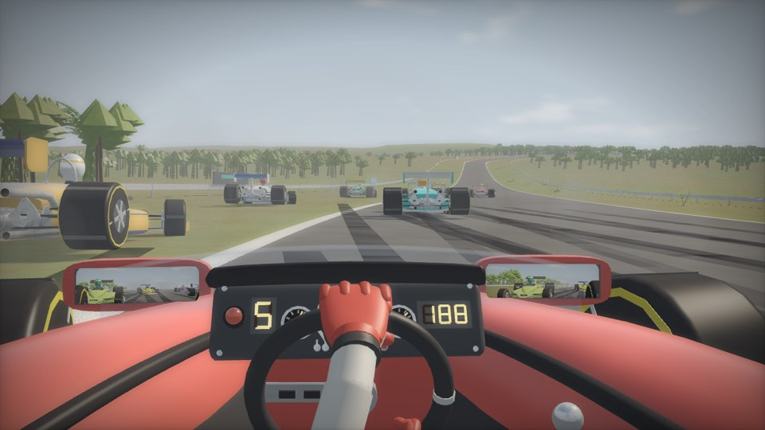

Val-Brûlé, midi, cockpit. L'intérieur de l'habitacle, le dessous des ailerons et la piste reçoivent le même fond de
lumière : le terme d'ambiance ne dépend que de l'orientation vers le haut (`renderer.js:833`), sans occlusion ni
couleur du ciel. Au loin, tout se noie dans une brume grise uniforme. Le coin de l'image est assombri deux fois : par le
shader (`renderer.js:923-924`, jusqu'à −41 %) puis par `#vignette` de `style.css`.

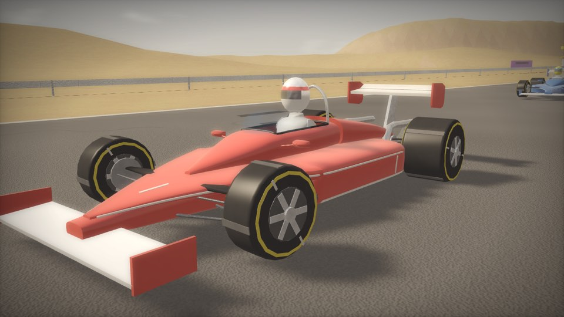

Roche-Fauve. La peinture rouge vire au saumon. La courbe de tons `c/(c+0,76)` s'applique canal par canal
(`renderer.js:914`). Le rouge, fort, est plus comprimé que le vert et le bleu, faibles, et la couleur se délave.
Exemple : un rouge éclairé (1,5 ; 0,15 ; 0,11) sort à (0,83 ; 0,44 ; 0,39) au lieu de (0,83 ; 0,29 ; 0,25). La
peinture n'a qu'un reflet de plastique satiné, sans vernis. Les pneus sont d'un noir uniforme. Le grain de l'asphalte
est le même partout. L'ombre de la voiture commence à distance des roues.

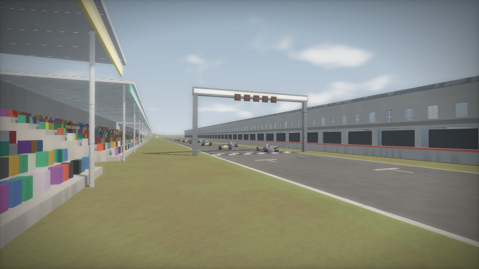

Les gradins sous le toit sont éclairés comme en plein air : rien ne dit au shader qu'un toit cache le ciel.

### 1.2 Ombres

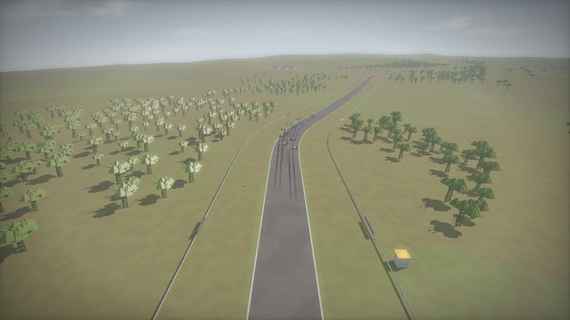

Le soleil n'a qu'un carré d'ombre de 200 m de côté. En cockpit, il va de 24 m derrière à 176 m devant
(`jeu.js:133`, `jeu.js:1715`). Dans les vues de télévision, d'hélicoptère et au sol, il est centré sur la voiture,
à ± 100 m. Au-delà, les arbres n'ont plus d'ombre. La bande de fondu, entre 2 et 17 m du bord du carré
(`renderer.js:449`), avance avec la voiture : les ombres naissent devant le pilote. BITUME donne tout l'atlas au
soleil (`sunOnly`, `renderer.js:2917`) : en Fine (atlas 2048), un texel couvre 9,8 cm ; en Moyenne (1024), 19,5 cm.
Le filtre (B-spline à neuf lectures, `renderer.js:429-441`) donne la même pénombre partout : environ 1,3 texel de 10
à 90 %, soit 13 cm en Fine et 25 cm en Moyenne.

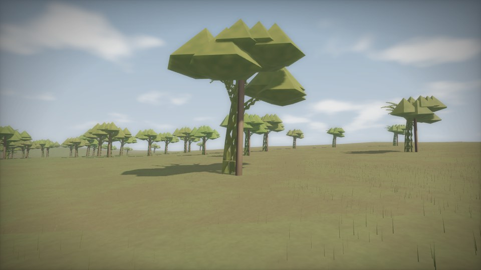

L'ombre d'un feuillu est une tache pleine. La couronne, faite de gros volumes opaques, ne laisse passer aucune
lumière. Le pied du tronc n'est pas assombri. Dans l'ombre, il reste 5,5 % du soleil (`renderer.js:450`) plus
l'ambiance uniforme : l'ombre est juste « posée ».

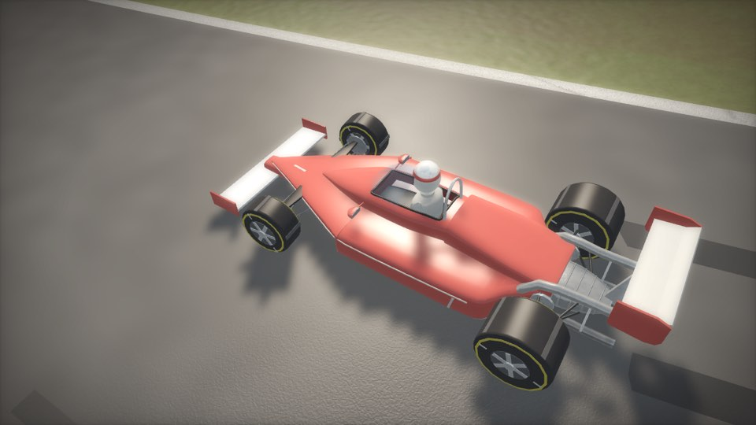

Sur la carrosserie, l'ombre propre est pâteuse : un texel de 10 cm couvre des pièces de 2 à 5 cm. L'ombre au sol
démarre à distance des pneus. Causes probables : le biais de profondeur (`renderer.js:424`, de 4 à 11 cm le long du
rayon pour un soleil à 40° de hauteur), le décalage de 1,4 cm selon la normale (`renderer.js:415`) et le filtre. La
voiture flotte.

### 1.3 Brume et relief

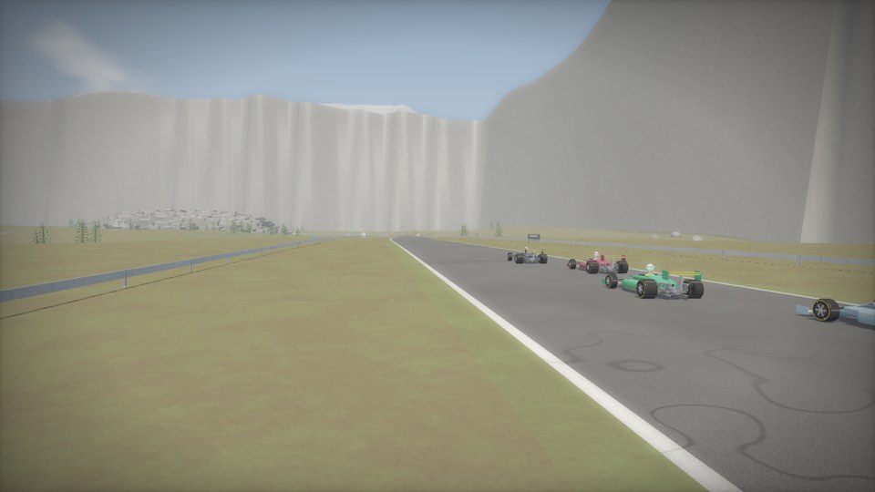

Haut-Col. Les falaises, à 1 ou 2 km, deviennent des rideaux de plâtre. La brume est une couleur unique, exponentielle
avec la distance et plafonnée à 86 % (`renderer.js:910-913`). Elle ne dépend ni de l'altitude ni de la direction du
soleil.

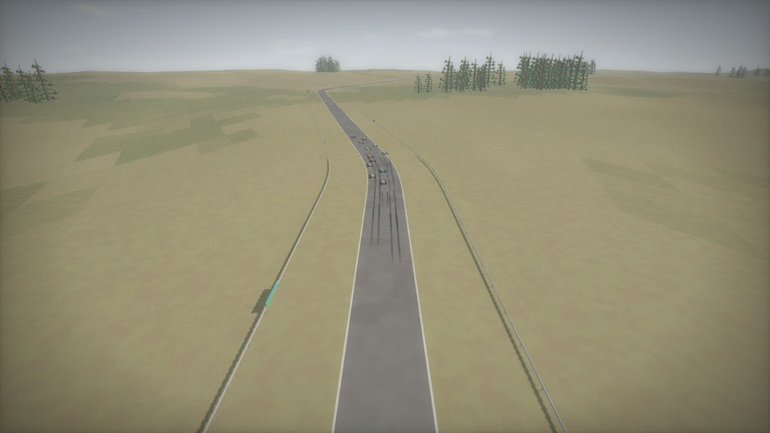

Cap-Séquoia vu de haut : le terrain est coloré par triangle (aplats de couleur, facettes visibles).

### 1.4 Eau

| Port-Sable, rivage | Port-Sable, vue plongeante |
|---|---|
| 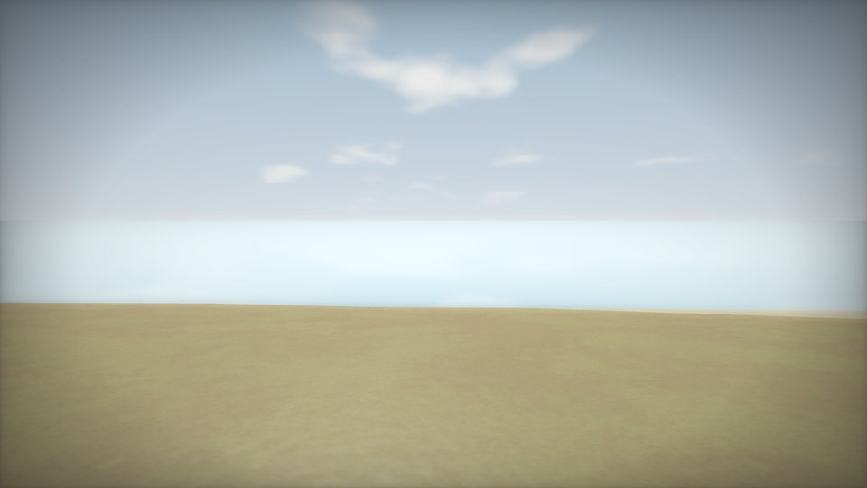 | 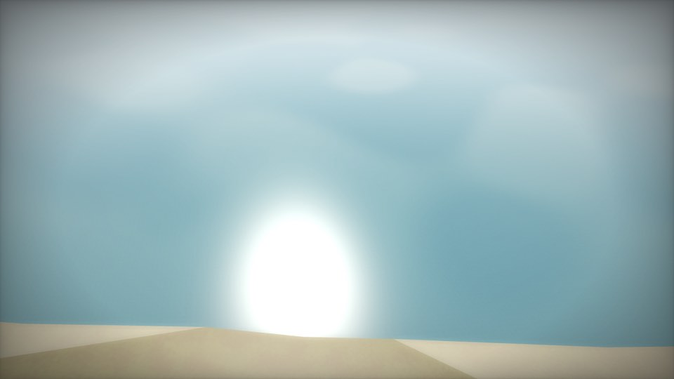 |
| **Cap-Séquoia, pied de falaise** | **Port-Sable, nuit** |
| 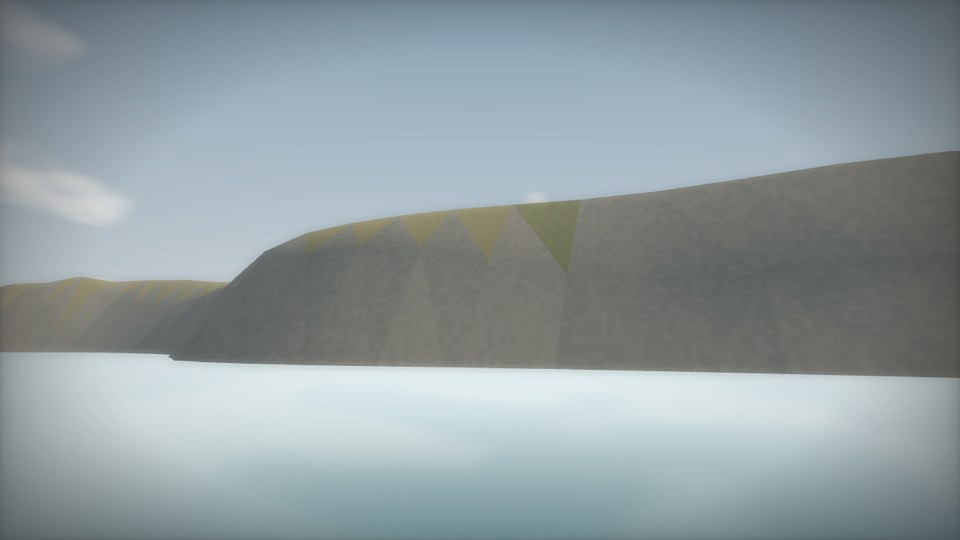 | 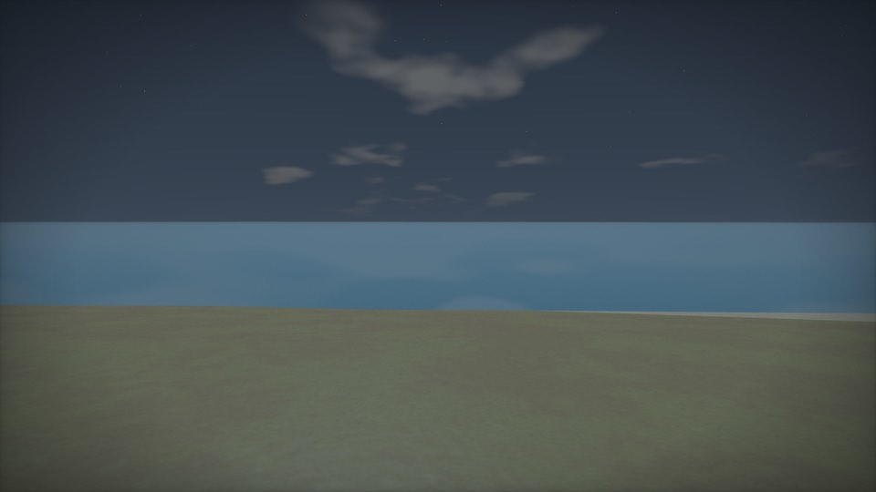 |

La mer est un plan plat de 5,2 km (`decor.js:413-420`, `sea: false` dans `jeu.js:2703`). Son matériau
(`renderer.js:664-665`) est en partie métallique (0,35). Le reflet du ciel y est multiplié par environ 1,6
(`renderer.js:896`), puis renforcé en Fine (`uPhoto`, `renderer.js:899-907`). La mer renvoie donc plus de lumière que
le ciel ne lui en donne : elle est laiteuse et plus claire que lui. Sans vagues, le soleil s'y reflète en une ellipse
blanche géante. Il n'y a ni couleur de profondeur, ni écume au rivage ni au pied des falaises. L'horizon est une
ligne dure.

La nuit, la brume (0,045 ; 0,065 ; 0,095) est plus claire que le bas du ciel (0,035 ; 0,055 ; 0,085)
(`ambiance.js:19-22`) : la mer lointaine, noyée de brume, paraît plus claire que le ciel.

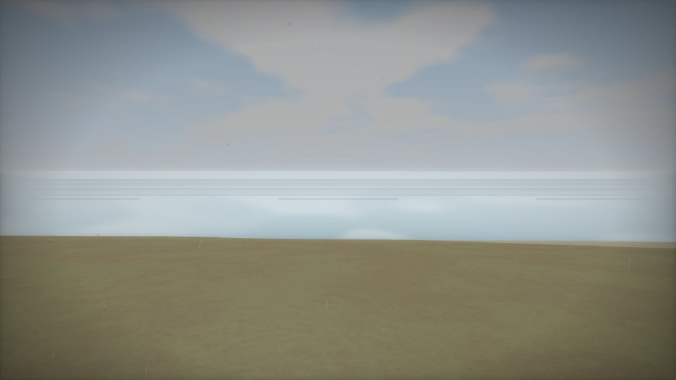

Sous la pluie, des bandes horizontales traversent la mer près de l'horizon, et le ciel garde de grandes trouées
bleues. La cause des bandes n'est pas établie : probablement les reflets d'écran à angle rasant.

### 1.5 Piste mouillée

| Piste mouillée | Monoplace sous la pluie |
|---|---|
| 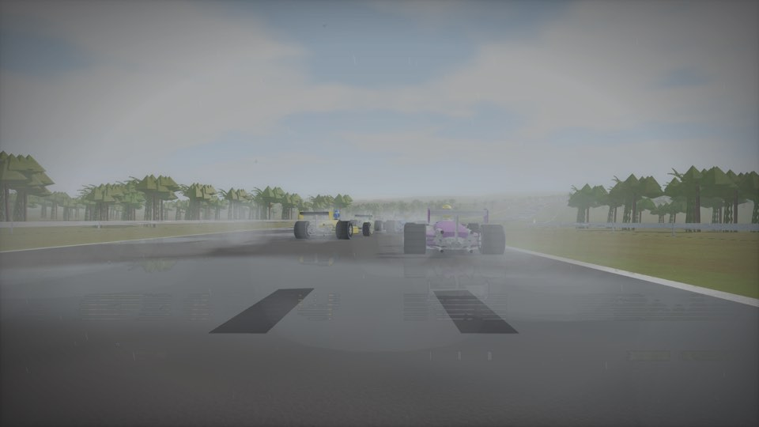 | 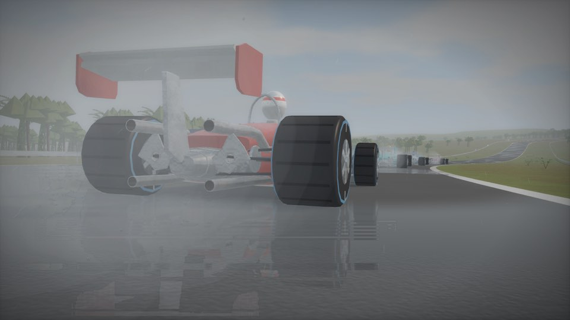 |

Les reflets d'écran (`SSR_FRAG`, `renderer.js:1061-1085`) sont calculés en demi-résolution. Leur normale est
reconstruite par les dérivées de la profondeur (`renderer.js:1070`). Le reflet des voitures sort en marches
d'escalier, comme un miroir parfait : ni flou selon la rugosité, ni étirement vertical. Il n'y a pas d'ondes de
pluie dans les flaques. Les gerbes sont des sphères translucides.

### 1.6 Crépuscule, nuit, tunnel

| Crépuscule | Nuit |
|---|---|
| 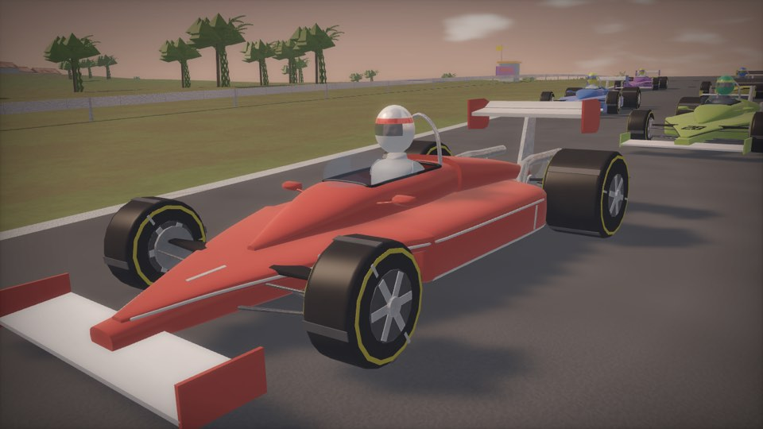 | 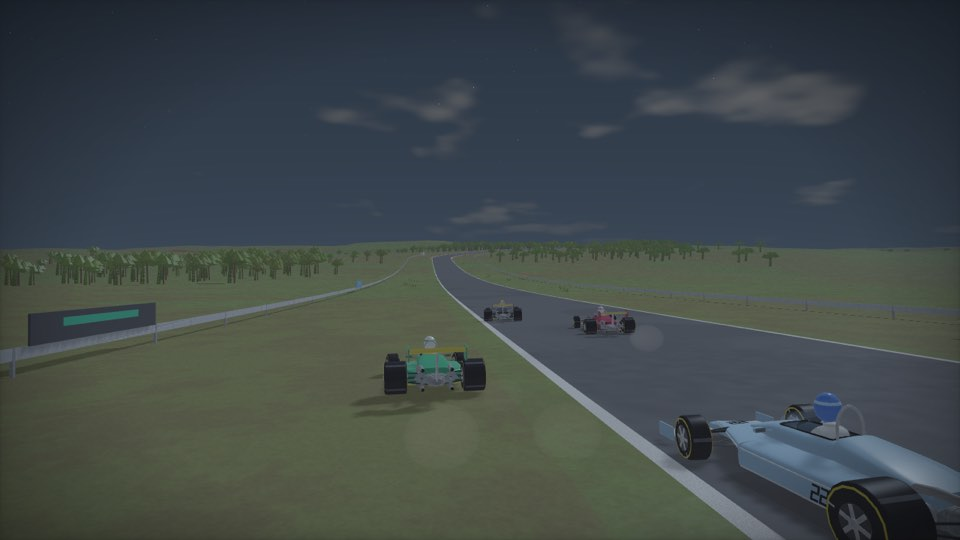 |

Le soleil garde sa direction de midi au crépuscule et la nuit : la direction est fixée par circuit
(`decor.js:57-84`), et `ambiance.js` ne change que les couleurs. Au couchant, les ombres sont courtes sous un ciel
rose uniforme. La nuit, l'ambiance (0,15 à 0,30) éclaire le sol comme un jour couvert. Aucune lampe ne borde la piste.

| Dans le tunnel | Sortie du tunnel |
|---|---|
| 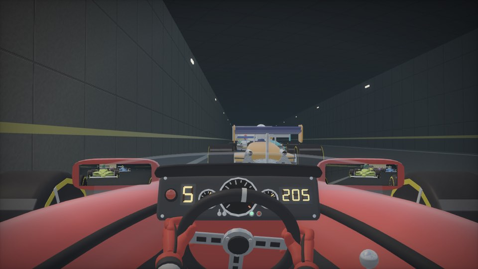 | 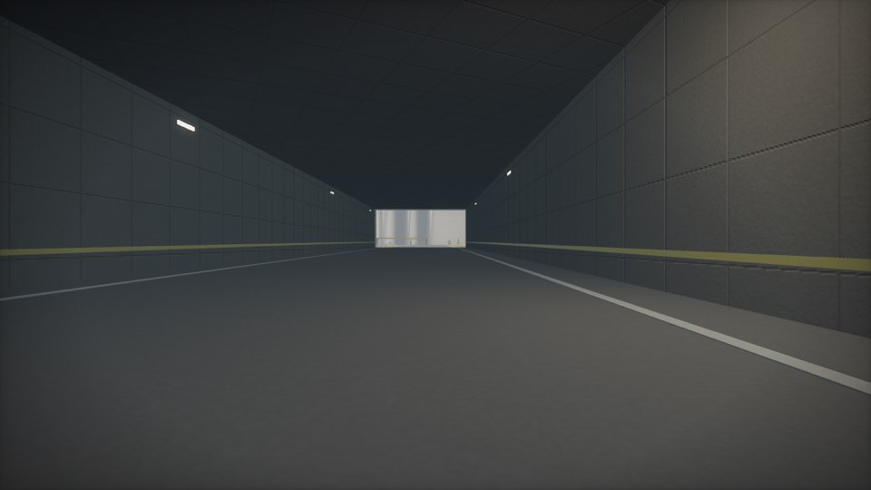 |

Dans le tunnel, les lampes se voient, mais les murs ne reçoivent qu'un dégradé régulier, sans flaque de lumière
sous chaque lampe. L'adaptation de l'œil (`S.lumiere`, jusqu'à 1,32, `jeu.js:1796-1807`) n'a aucun effet (mesure en
§ 2.3). La sortie est un rectangle blanc, sans éblouissement. Le jour et la nuit donnent la même image sous la voûte.

### 1.7 Saisons

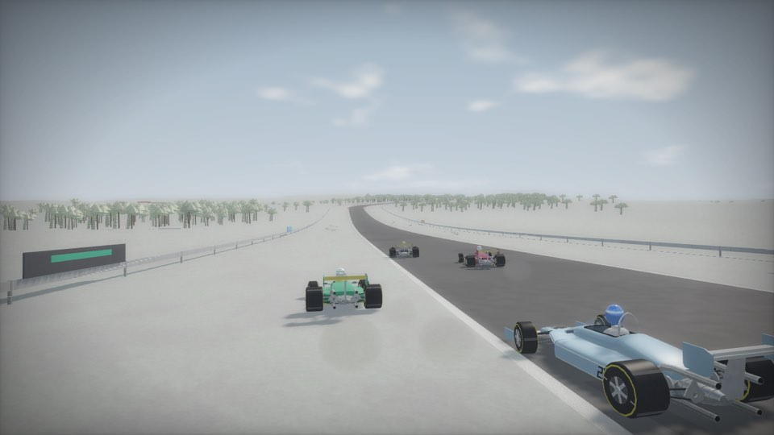

La neige est d'un gris uniforme, sans ombre bleutée ni scintillement.

## 2. Mesures

Outils : `tools/page-essai.mjs` (Chrome 157 sans interface, rendu par ANGLE Metal sur la puce Apple M5 du Mac de
David, [gpu.json](rapports/photo-2026-11-18/mesures/gpu.json)) et les modèles de
[outils/](rapports/photo-2026-11-18/outils/). Résultats bruts : [mesures/](rapports/photo-2026-11-18/mesures/).

**Méthode du coût.** Chaque image principale est encadrée par la lecture d'un pixel de l'image finale. Cette lecture
force l'attente du GPU. `gl.finish()` ne bloque pas dans Chrome : un premier essai avec lui donnait 1,6 ms pour
5 millions de triangles, soit le seul temps de soumission (essai non conservé). Le temps compte donc la soumission et
l'exécution d'une seule image, sans recouvrement : il surestime le temps réel, mais il compare bien deux variantes.
Les variantes alternent **image par image** dans une même séance, rétroviseurs coupés. D'une séance à l'autre, la
machine dérive. La même configuration (Val-Brûlé, cockpit, Fine, 2880 × 1514) a mesuré 21,9 ms à 17 h 23
([couts-fine-soleil.json](rapports/photo-2026-11-18/mesures/couts-fine-soleil.json)), 18,8 ms à 17 h 24
([couts-fine-soleil-b.json](rapports/photo-2026-11-18/mesures/couts-fine-soleil-b.json)), puis 23,7 à 24,0 ms à
17 h 39 (`ab-origine-c0-*.json`). Deux constructions différentes se comparent donc par séances alternées, jamais à
heures différentes.

**Limite : la machine n'était pas au repos.** D'autres navigateurs et processus Node tournaient. À 17 h 57, la charge
moyenne valait 33 sur une minute et 11 sur quinze. Une séance de contrôle lancée alors a donné 44,6 ms pour l'image
complète et 30,9 ms sans ombres ([controle-charge-1757.json](rapports/photo-2026-11-18/mesures/controle-charge-1757.json)).
Les coûts du § 2.1 viennent des séances de 17 h 23 à 17 h 43. Ils sont cohérents entre eux (ombres de 2,7 à 2,8 ms
dans trois séances) et suffisent pour classer les effets. Il faut les refaire sur une machine au repos avant toute
décision chiffrée.

### 2.1 Coût par poste (Val-Brûlé, cockpit, médiane de 50 images par variante)

| Réglage, toile | Image complète | Sans ombres | Ombres | Sans reflets | Reflets d'écran |
|---|---|---|---|---|---|
| Fine, 2880 × 1514, soleil | 18,8 ms | 16,1 ms | **2,7 ms** | — | — |
| Fine, 2880 × 1514, pluie | 20,4 ms | 17,6 ms | **2,8 ms** | 19,8 ms | **0,6 ms** |
| Fine, 1440 × 757 | 10,9 ms | 9,1 ms | 1,8 ms | — | — |
| Moyenne, écran de densité 2 rendu en 1440 × 757 (atlas 1024) | 7,8 ms | 7,0 ms | 0,8 ms | — | — |

Entre 1440 × 757 et 2880 × 1514, l'image Fine prend 7,9 ms pour 3,3 millions de pixels de plus : environ **2,4 ms
par million de pixels**. Il reste environ 8 ms de part fixe (triangles, soumission). Une passe plein écran
supplémentaire en Fine se paie donc en fractions de milliseconde, une passe de géométrie en millisecondes. Le
renfort « photo » de Fine (`uPhoto`) ne coûte rien de mesurable : 18,9 ms sans, 18,8 ms avec. Le halo n'a pas pu
être isolé : sans halo, l'image est noire (§ 2.4).

### 2.2 Scintillement des ombres

Indice : pour chaque pixel d'une région, on suit sa luminance d'une image à l'autre. `d1` est la variation moyenne
entre deux images (sur 255). `d2` est l'écart à la droite des deux voisines : une dérive lente s'annule, un
aller-retour reste.

| Scène (80 à 90 images, 1280 × 720) | Fine (texel 9,8 cm) | Moyenne (19,5 cm) | Sans ombres |
|---|---|---|---|
| Feuillu fixe, carré d'ombre qui suit la voiture (vue télé), vent figé | d1 0,008 | d1 0,008 | d1 0,007 |
| Même scène, vent libre | d1 0,085 | — | d1 0,075 |
| Cockpit, deux régions de carrosserie | d2 0,38 / 0,85 | d2 0,35 / 0,91 | d2 0,33 / 0,86 |

Le carré d'ombre a avancé de 0,9 m par image sur 70 m. Avec le décor immobile (vent figé), l'image ne bouge pas plus
que sans ombres : l'accrochage du carré au texel (`renderer.js:2919-2920`) fonctionne. Avec le vent, les ombres
n'ajoutent presque rien au mouvement de la végétation elle-même. En cockpit, les régions choisies ne reçoivent pas
d'ombre dans ce cadrage (même niveau moyen avec ou sans ombres) : **ce test ne prouve rien pour l'habitacle**.

Le scintillement du 16/11 n'est donc pas reproduit. Restent quatre pistes à vérifier là où David l'a vu :
1. la qualité Auto qui coupe puis rétablit les ombres (niveau 2 du gouverneur) : les ombres apparaissent et
   disparaissent pendant des secondes ;
2. le bord du carré, où les ombres naissent en avançant ;
3. les brins d'herbe, plus fins qu'un texel, dans la passe d'ombre avec le vent (le sous-lot 5B-3 les en retire) ;
4. l'ombre propre de l'habitacle, à texels de 10 cm (non mesurée ici).

### 2.3 Adaptation de l'œil au tunnel

Haut-Col, cockpit sous la voûte : une image sur deux reçoit `brightness: 2`, l'autre `0,5`. Rapport des luminances
moyennes : **1,0011**. L'adaptation est inerte. Le moteur n'applique `fx.brightness` que dans `applyScreen`, ajouté
seulement avec `options.composition` (`renderer.js:2598`), que BITUME n'ouvre pas (`jeu.js:2703`). Les éclairs de
choc (`fx.damage`, `fx.pulse`) passent par le même chemin.

### 2.4 Constat annexe : Légère avec MSAA 4× donne un écran noir

Réglages Légère et anticrénelage « MSAA 4× » : image entièrement noire
([annexe-legere-msaa4.jpg](rapports/photo-2026-11-18/images/annexe-legere-msaa4.jpg)). La copie du tampon MSAA vers
l'écran (`blitFramebuffer`, `renderer.js:3204-3207`) échoue avec `INVALID_OPERATION` ([noir.json](rapports/photo-2026-11-18/mesures/noir.json)).
Le contexte est créé sans canal alpha (`renderer.js:2387`), et WebGL 2 n'accepte la résolution d'un tampon
multi-échantillon que vers un format identique. `FERRO-REFERENCE.md` (0.3.6) affirme pourtant que « le MSAA demandé
explicitement fonctionne aussi sans halo ». Mesuré sans interface ; à confirmer en fenêtre. La correction est dans
FERRO : résoudre vers une texture puis la dessiner, ou créer le contexte avec alpha.

### 2.5 Maquette : coût en séances alternées

Trois séances par construction, en alternance (temps de l'image principale, médiane de 50 images) :

| Scène, Fine 2880 × 1514 | Base 0.2.39 | Maquette |
|---|---|---|
| Val-Brûlé, cockpit | 24,0 · 23,7 · 23,9 ms | 23,3 · 24,5 · 21,5 ms |
| Port-Sable, mer en vue plongeante depuis 28 m (la mer remplit l'essentiel du cadre) | 12,8 · 14,6 · 11,2 ms | 14,0 · 15,0 · 16,5 ms |

Sur la forêt, aucune différence au-delà du bruit (± 1,5 ms). Sur la mer : **+2,2 ms** en médiane. C'est le prix des
neuf bruits calculés par pixel d'eau pour les vagues. Ils doivent devenir deux lectures de texture (E2).

## 3. Comment le moteur éclaire aujourd'hui

`src/moteur/renderer.js` (verrouillé, commun aux quatre jeux de FERRO), shader du monde `FRAG` (lignes 311 à 932) :

- **Soleil** : `uSunColor × N·L × ombre` (`renderer.js:850-852`). L'ombre vient d'un seul carré (`sunShadowPass`,
  `renderer.js:2913`), accroché au texel, filtré en B-spline, avec biais selon la pente et décalage selon la normale.
- **Ambiance** : `uAmbient × (0,72 + 0,28 × n.y)` en extérieur (`renderer.js:829-833`). L'occlusion `cavity` ne
  touche que les matières naturelles. Il n'y a rien d'autre : ni ciel directionnel, ni sol, ni abri.
- **Reflets** : un ciel analytique (dégradé, nuages, lobe du soleil, `renderer.js:877-896`) avec un gain qui dépasse
  1. En Fine, un « boost photo » ajoute un reflet net du soleil et un renvoi du sol (`renderer.js:897-907`). Sous la
  pluie, en Fine, des reflets d'écran en demi-résolution (`SSR_FRAG`).
- **Lampes** : douze emplacements (`renderer.js:837`), dont huit lampes passagères en Moyenne et Fine, quatre en
  Légère (`renderer.js:3084`), avec cônes et portées. Le tunnel s'en sert.
- **Brume** : exponentielle de la distance, couleur unique, plafond à 86 % (`renderer.js:910-913`).
- **Tons** : `c/(c+0,76)` par canal, puis gamma 1/2,2, **dans chaque shader** : monde (914), effets (997), ciel
  (1056), foule de Point de rupture (1204), ciel physique FSky (`skies.js:132`). La cible de scène est en 8 bits par
  canal : le halo (`POST_FRAG`, un seul niveau au quart de la résolution) travaille sur des couleurs déjà comprimées.
  Il n'y a pas d'exposition. Le seul tramage est celui de FSky : celui de la composition d'écran
  (`options.dither`) n'est pas ouvert par BITUME.
- **Déjà disponible et inutilisé par BITUME** : le ciel physique FSky (`skies.js`, `options.advancedSky`), dont la
  brume prend la couleur du ciel dans la direction regardée (`renderer.js:2626-2633`). Aussi : les vagues de mer
  (`seaField`, `renderer.js:186`, `sea: true`), les reflets de scène par sonde et écran (`reflections.js`) et la
  composition d'écran (`options.composition`).

## 4. État de l'art retenu pour WebGL 2

Sources en § 9. Seules les techniques qui tiennent dans un renderer avant (forward) WebGL 2, sans prépasse de
profondeur, sont retenues en priorité. Une passe de géométrie de plus coûterait environ la part fixe de l'image
(§ 2.1).

- **Ombres stables** : accrochage au texel (Valient, ShaderX6) ; déjà en place et vérifié. Les cascades étendent la
  portée. Ici, le soleil est fixe pendant toute la course : une carte lointaine **calculée une fois au chargement**
  remplace une cascade lointaine redessinée à chaque image.
- **Pénombre variable** : PCSS (Fernando, NVIDIA 2005). Une recherche des bloqueurs donne la largeur de pénombre
  `(d_récepteur − d_bloqueur) × taille_lumière / d_bloqueur`. Le soleil sous-tend 0,53° : sa pénombre réelle est
  courte (≈ 9 cm sous une couronne à 10 m). Le gain visible : contact net, couronnes hautes plus douces.
- **Ombres de contact en espace écran** : marche dans la profondeur vers la lumière (Unreal, Unity, Bevy). Elles
  demandent la profondeur avant l'éclairage, donc une prépasse ici : écartées au profit d'une occlusion analytique
  des voitures (formes connues) et d'une tuile d'ombre dédiée à la voiture filmée.
- **Occlusion ambiante** : GTAO (Jimenez et al. 2016), environ 0,5 ms sur console en demi-résolution avec filtrage.
  Ici, la profondeur n'est copiée qu'avec les reflets d'écran. GTAO viendrait en dernier, dans un palier haut, appliqué
  à la part ambiante de la lumière.
- **Lumière du ciel** : harmoniques sphériques d'ordre 2, soit 9 coefficients (Ramamoorthi et Hanrahan 2001), pour
  l'éclairement diffus d'un ciel quelconque : 9 uniformes, une vingtaine d'opérations par pixel. FSky sait déjà rendre
  la radiance du ciel dans toute direction (`FSky.radianceAt`, `skies.js:246`) : la projection se fait en JavaScript,
  au chargement et à chaque changement d'ambiance.
- **Atmosphère et perspective aérienne** : tables de Hillaire (2020), adaptables du mobile au PC. FSky en est une
  version légère à tables uniformes (30 entrées). Brume à la Quilez : couleur qui tire vers le soleil dans sa
  direction, extinction et diffusion séparées, densité qui décroît avec l'altitude, intégrée analytiquement.
- **Exposition automatique** : moyenne du logarithme de la luminance (réduction par mipmaps), adaptation exponentielle
  à vitesses différentes vers le clair et vers le sombre (Unreal, Unity). Sans aucune relecture CPU : la valeur reste
  dans une texture 1 × 1 lue par les shaders à l'image suivante.
- **Courbes de tons** : ACES déplace les teintes saturées, AgX rend les hautes lumières avec plus de naturel au prix
  de la fidélité des couleurs, et Khronos PBR Neutral garde la couleur de base jusqu'aux hautes lumières. Pour BITUME,
  dont les palettes sont réglées sur la courbe actuelle, la voie la plus sûre consiste à garder la même courbe sur les
  gris et à l'appliquer à la teinte entière (maquette).
- **Halo** : pyramide de sous-échantillonnage (13 lectures) et de suréchantillonnage en tente (Jimenez, Call of Duty
  AW 2014), stable dans le temps. Le seuil se fait en énergie, ce qui demande une scène en virgule flottante.
  RGBA16F n'est rendu possible que par `EXT_color_buffer_half_float` ou `_float` : absent sur certains téléphones, et
  iOS n'a pas la version 32 bits.
- **Eau** : somme de vagues de Gerstner (Finch, GPU Gems 2004) ou spectre, détail porté par des cartes de normales qui
  défilent ; Fresnel de Schlick avec F0 ≈ 0,02 ; absorption de Beer-Lambert selon la hauteur d'eau ; écume selon la
  distance au rivage.
- **Surfaces mouillées** : assombrissement par porosité, rugosité basse, flaques, anneaux d'impact (Lagarde 2013,
  Tatarchuk 2006). Les reflets des feux sont étirés verticalement sur l'asphalte mouillé.
- **Scintillement spéculaire** : élargir la rugosité selon la variation des normales dans le pixel (Kaplanyan 2016,
  Tokuyoshi 2019). FERRO le fait déjà en partie (`renderer.js:799-800`).
- **Rayons du soleil** : flou radial depuis le soleil sur un masque au quart de la résolution (Mitchell, GPU Gems 3).
- **Anticrénelage temporel** : fantômes et flou, à traiter par clamp ou clipping de voisinage (Karis 2014, Salvi 2016).
  Inutile tant que le MSAA tient : à éviter.

## 5. Plan

Règles communes à tous les effets :

- `renderer.js`, `skies.js` et `materials.js` sont des copies verrouillées, communes aux quatre jeux. Chaque
  changement se fait dans `M4D135/FERRO`, derrière une **option qui conserve l'image historique par défaut**, puis se
  propage par `tools/install-ferro.py`. BITUME ouvre l'option. Si FERRO garde la parité GLSL/WGSL, chaque shader
  change dans les deux langages : `src/ferro/webgpu-shaders.js`, généré depuis le GLSL par Naga, porte aussi la courbe
  de tons et doit être régénéré.
- Tout se prépare au chargement : aucune allocation par image en course, aucune cible créée en course. Un effet
  coupé l'est par un uniforme ou une branche, avec sa cible gardée.
- La simulation n'est pas touchée. Toute variation visuelle tire son hasard d'une graine propre à l'effet, jamais du
  hasard de course.
- Chaque effet se mesure en séances alternées (§ 2) et se photographie avant et après, avec les prises de ce lot.
  L'indice de scintillement (`scintillement.js`) reste sous 0,01 sur le décor immobile.
- Légère ne perd rien. Les effets à coût nul pourraient l'améliorer : c'est une décision de David (question 6).

Les coûts sont **estimés** pour Fine en 2880 × 1514, sauf mention « mesuré ».

### Étape 1 — Ombres : stabilité, douceur, contact

**O1. Contact des voitures (occlusion analytique).** On verra les monoplaces posées sur la piste : un assombrissement
doux sous la caisse et un contact net sous chaque pneu, en Légère aussi, où il n'y a pas d'ombre du tout. Technique :
le jeu passe à FERRO, par un tableau réutilisé, les voitures proches (au plus 6 à moins de 60 m, 4 en Légère),
chacune sous forme de boîte orientée et de quatre appuis. Le shader du monde calcule pour chaque pixel de sol une
occlusion analytique d'ellipsoïde et de disques (formules fermées), sans texture. Coût : environ 20 opérations par
voiture et par pixel de sol proche, aucune cible, aucune lecture de texture : de l'ordre de 0,1 à 0,3 ms. Palier :
tous. Coupure : nombre de voitures à 0. FERRO : `fx.contacts = { nombre, boites: Float32Array }`, uniformes
`uContact*`, terme multiplié sur l'ambiance et, plus faiblement, sur le soleil. Risques : une voiture qui s'assombrit
elle-même (exclure les pixels de la carrosserie par le matériau), un saut quand une voiture entre dans la liste
(fondu selon la distance).

**O2. Ombres lointaines précalculées.** On verra des arbres, tribunes et reliefs ombrés jusqu'à l'horizon, sans bande
qui avance. Technique : le soleil ne bouge pas pendant une course (`decor.js:57-84`). Au chargement, FERRO dessine une
fois tout le décor statique dans une carte de profondeur couvrant le circuit : 2048², soit environ 1,5 m par texel
pour 3 km. Le shader la lit hors du carré proche, avec un fondu croisé dans la bande. Coût : une lecture (quatre avec
filtre) pour les seuls pixels lointains ; 8 Mo en profondeur 16 bits ; une passe de profondeur au chargement (phase de
chargement du 5B-9). Palier : Moyenne et Fine (Légère : question 6). Coupure : uniforme. FERRO :
`rendu.precalculerOmbre({ centre, etendue, taille })` et une seconde matrice d'ombre. Risques : les arbres agités par le
vent y restent immobiles (invisible au loin) ; si le crépuscule change la direction du soleil (L10), il faut recalculer
la carte au chargement, et par tuiles réparties sur plusieurs images en mode cycle.

**O3. Tuile d'ombre de la voiture filmée.** On verra en cockpit des ombres nettes et stables du volant, des mains, des
rétroviseurs et de l'arceau sur la planche et la carrosserie, et l'ombre propre de la voiture en vue extérieure.
Technique : une petite carte de profondeur (512², 1 Mo) couvre 7 m autour de la voiture suivie, soit 1,4 cm par texel.
Elle reçoit cette voiture et l'habitacle. Le shader la choisit dans sa boîte, sinon il prend le carré du soleil.
Coût : une passe de profondeur d'une voiture (quelques dizaines de milliers de triangles) et neuf lectures sur ses
seuls pixels : environ 0,1 à 0,2 ms. Palier : Moyenne et Fine. Coupure : uniforme ; la cible reste allouée. FERRO :
`fx.ombreProche = { centre, etendue }` ; l'habitacle (`overlay`) doit entrer dans cette passe à sa position réelle.
Risque : une couture entre les deux cartes au bord de la boîte (fondu sur 30 cm).

**O4. Pénombre selon la distance et la météo.** On verra des ombres de couronnes plus douces que celles des poteaux,
un contact plus net, des ombres presque effacées sous un ciel couvert. Technique : PCSS allégé dans le carré proche
(quatre lectures de recherche, puis le filtre actuel élargi de 1 à 4 texels). Le rayon et le contraste suivent aussi
la couverture nuageuse (`uWeather`). Coût : quatre lectures de plus par pixel éclairé du carré : environ 0,3 à
0,6 ms. Palier : Fine ; en Moyenne, seule la partie météo, gratuite. Coupure : uniforme. Risque : bruit de
l'échantillonnage. Prendre une rotation fixe par pixel, jamais variable dans le temps : sans anticrénelage temporel,
toute variation se verrait.

**O5. Surveillance du scintillement.** L'outil de ce lot devient une vérification : décor immobile, carré qui suit
la voiture, `d1` sous 0,01. Il faut aussi journaliser le niveau du gouverneur Auto pour confirmer ou écarter la
piste 1 du § 2.2. Coût nul en jeu.

**O6. Ombres de contact en espace écran et GTAO.** Écartés pour l'instant : ils demandent la profondeur de l'image
avant l'éclairage. Ils reviendront après le 5B, dans un palier au-dessus de Fine, avec la profondeur déjà copiée pour
les reflets d'écran (L8).

### Étape 2 — Lumière : ciel, occlusion, exposition, matières

**L1. Courbe de tons qui garde la teinte (maquette).** On verra les gris inchangés, des couleurs franches (rouge
rouge, bleu de ciel plus profond) et des hautes lumières qui blanchissent encore. Technique : la courbe actuelle est
appliquée au canal le plus fort, puis à toute la couleur, et rejoint la courbe par canal au-delà de 2. Coût mesuré :
nul (§ 2.5). Palier : tous. FERRO : une fonction GLSL unique, option `tons: 'teinte'`, à utiliser aux six endroits
du § 3 et dans le rendu Canvas 2D de secours (`renderer.js:2234`, `1855`) pour qu'il reste cohérent. Risque : tout le
jeu change d'aspect, les palettes ont été réglées sur l'ancienne courbe. Herbe et sable sortent plus saturés dans la
maquette : prévoir une passe de réglage des palettes (`decor.js`, `ambiance.js`, `saisons.js`).

**L2. Une exposition qui agit.** On verra le tunnel s'éclaircir en entrant et éblouir en sortant, comme `jeu.js` le
prévoit déjà. On pourra aussi faire une nuit vraiment sombre, où les lampes et les phares comptent (L10). Technique :
`fx.brightness` multiplie la couleur avant la courbe de tons dans les shaders du monde, du ciel et des effets, sans
composition. Coût : nul. Palier : tous. FERRO : uniforme `uExposition`. Corrige le constat du § 2.3.

**L3. Lumière du ciel directionnelle.** On verra le dessus des objets bleuté par le ciel, le dessous réchauffé par le
sol, et le côté du soleil plus clair même à l'ombre. Les ombres prennent la couleur du ciel. Technique : neuf
coefficients d'harmoniques sphériques, calculés en JavaScript au chargement et à chaque changement d'ambiance, sans
allocation (un `Float32Array(27)` réutilisé). Ils viennent de FSky si L4 est ouvert, sinon des couleurs de ciel, de sol
et de soleil de l'atmosphère. La maquette montre une version à deux couleurs (hémisphère). Coût : environ 25 opérations
par pixel, aucune lecture ; nul en mesure pour l'hémisphère de la maquette. Palier : tous. FERRO : `uCielSH[9]` à la
place du terme de `renderer.js:833`. Risque : l'exposition moyenne bouge : normaliser sur l'ancien terme.

**L4. Ciel physique et brume vraie.** On verra un ciel plus clair autour du soleil et vers l'horizon, une brume qui
prend la couleur du ciel dans la direction regardée, chaude à contre-jour et bleue dos au soleil, et des montagnes de
Haut-Col qui gardent leur relief : la brume s'épaissit en vallée et s'éclaircit en altitude. Technique : FSky existe
déjà (`advancedSky`) ; BITUME lui donne un préréglage par circuit et par ambiance. Dans FERRO : densité de brume
intégrée selon l'altitude (formule fermée, altitude de référence par circuit), extinction et diffusion séparées,
plafond de 86 % levé quand l'horizon du ciel et la brume ont la même couleur. Coût : la passe de ciel FSky sur les
pixels de ciel (nuages en bruit à quatre octaves : à mesurer avant de l'ouvrir en Légère) et une vingtaine
d'opérations de brume par pixel. Palier : tous, avec moins de couches de nuages en Légère. La maquette n'a teinté la
brume que par le soleil : les falaises de Haut-Col restent plâtrées
([c2-bord-maquette](rapports/photo-2026-11-18/images/c2-bord-maquette.jpg)). C'est la densité selon l'altitude qui
manque. Risque : la couleur des circuits change ; prévoir des préréglages FSky réglés à l'œil, circuit par circuit.

**L5. Occlusion du couvert et des abris (précalculée).** On verra le sol sombre sous les arbres même dans le soleil,
les gradins sous le toit dans la pénombre et l'entrée du tunnel qui s'assombrit progressivement. Technique : au
chargement, BITUME peint une texture d'occlusion du ciel sur l'emprise du circuit (R8, 2048², environ 1 m par texel) à
partir des arbres, des toits et des bouches du tunnel. Le shader la lit pour réduire l'ambiance et le reflet du ciel,
sur le principe du voile de Point de rupture (`uVoile*`, `renderer.js:917-921`). Coût : une lecture par pixel
extérieur ; 4 Mo ; quelques millisecondes au chargement. Palier : tous. FERRO : `fx.occlusionSol = { texture, origine,
taille }`. BITUME : la peinture dans `decor.js` et un test dans `verifications/` (déterministe, mêmes octets à graine
égale). Pour la voiture, une occlusion par pièce (intérieur de l'habitacle, dessous) se règle dans `voiture.js`.

**L6. Exposition automatique.** On verra les contre-jours, les sous-bois et la nuit retrouver une lecture naturelle :
l'œil s'adapte en 0,3 s vers le clair et en 0,8 s vers le sombre, comme le tunnel le prévoit. Technique : luminance
logarithmique au quart de la résolution, mipmaps jusqu'à 1 × 1, adaptation dans une texture 1 × 1 en double tampon,
lue par les shaders à l'image suivante. Aucune relecture CPU. Coût : environ 0,05 à 0,1 ms ; moins de 1 Mo. Palier :
Moyenne et Fine ; Légère garde L2, scripté. Coupure : exposition fixée. Risque : pompage ; borner à ± 1 IL et filtrer.

**L7. Halo en pyramide et éblouissement.** On verra un halo large et doux autour du soleil, des phares et de la sortie
du tunnel, au lieu d'un petit halo serré. Technique : cinq niveaux de sous-échantillonnage et de suréchantillonnage à
partir de la moitié de la résolution, à la place du flou à un niveau de `POST_FRAG`. Coût : environ 0,3 à 0,5 ms ;
cibles de 1/2 à 1/32 de la résolution (environ 6 Mo en 8 bits). Palier : Fine. Coupure : halo actuel. Limite : sans
scène en virgule flottante, le seuil reste approximatif. Une scène RGBA16F doublerait la mémoire du MSAA (de 70 à
140 Mo en 2880 × 1514) et manque sur certains mobiles : à réserver au palier au-dessus de Fine (question 5).

**L8. GTAO.** On verra les coins, les pieds de murs, les rainures des glissières et les dessous de carrosserie
assombris. Technique : GTAO en demi-résolution, deux directions, filtre bilatéral, appliqué à la part ambiante de la
lumière. Celle-ci serait écrite par le shader du monde dans un second attachement R8. Coût : environ 1 à 1,5 ms plus la
copie de la profondeur multi-échantillonnée. Palier : au-dessus de Fine. À mesurer avant de promettre quoi que ce soit.

**L9. Matières.** Chacune se change à part, dans `materials.js` (FERRO) ou dans les recettes BITUME.
- *Peinture* : sous-couche colorée et vernis (second lobe spéculaire très lisse, F0 0,04) qui reflète le ciel. On
  verra une voiture laquée et non plastique. Environ 20 opérations sur les pixels de voiture ; tous paliers.
- *Pneus et jantes* : caoutchouc sombre rugueux, flanc légèrement plus clair, jante métallique (avec le lot 12B de
  `12-PLAN-MAITRE-RUSSIE-MONACO-PNEUS.md`, qui refait leur forme).
- *Asphalte* : granulats à deux échelles, variations à grande échelle (gomme sur la trajectoire, raccords, bords plus
  clairs), micro-reflets à contre-jour.
- *Terrain* : casser les aplats par triangle avec la couleur interpolée, un bruit à deux échelles et la pente (roche
  sur les pentes fortes) ; dans les nappes de `decor.js`, au chargement.
- *Neige* : ombres bleutées (vient avec L3), scintillement léger.
- *Scintillement spéculaire* : étendre la rugosité selon la variation des normales (`renderer.js:799-800`) à l'eau et
  à la piste mouillée.

**L10. Crépuscule et nuit.**
- *Soleil bas au crépuscule* : direction propre au moment (dans `ambiance.js`, avec l'atmosphère). On verra des ombres
  longues et une lumière rasante. La profondeur du volume d'ombre suit déjà la hauteur du soleil (`jeu.js:159-160`) ;
  vérifier le biais sous 15°.
- *Nuit* : une ambiance physiquement sombre et compensée par l'exposition (L2, L6). Des lampes de bord de piste et de
  tribunes réutiliseraient les huit lampes passagères, comme le tunnel. Les phares utiliseraient des cônes (déjà dans
  le shader). Un halo de brume autour des lampes : diffusion analytique le long du regard, une formule fermée par
  lampe. On verra une vraie nuit de course.
- *Tunnel* : flaques de lumière sous chaque lampe (portée et atténuation de `lampesTunnel`), reflet des lampes sur
  l'asphalte, éblouissement de sortie (L2 et L7).

**L11. Rayons du soleil.** On verra des rais de lumière à travers les arbres à contre-jour. Technique : flou radial de
32 à 64 lectures depuis la position du soleil, sur un masque de ciel au quart de la résolution. Environ 0,2 ms. Palier
au-dessus de Fine, facultatif.

### Étape 3 — Eau et piste mouillée

**E1. Eau diélectrique (maquette).** On verra une mer sombre en vue plongeante et claire à l'horizon (Fresnel), plus
jamais plus claire que le ciel. Technique : métal 0, F0 0,04 (0,02 visé), reflet sans gain ni « boost photo », couleur
de fond profonde (`renderer.js:664-665`, `896`, `899`). Coût mesuré : nul hors vagues. Palier : tous.

**E2. Vagues par texture de normales.** On verra une surface vivante, un chemin de reflets scintillants vers le soleil
et des vagues qui s'estompent au loin sans grésiller. La maquette donne l'image visée, mais avec neuf bruits par pixel
(+2,2 ms mesurés en mer plein écran). Technique : au chargement, une carte de normales répétable de 256² (somme de
vagues de Gerstner, graine propre). Deux lectures à deux échelles qui défilent dans deux directions, amplitude atténuée
avec la distance, rugosité qui croît au loin (anti-scintillement). Coût : deux lectures par pixel d'eau ; moins de
350 Ko avec mipmaps. Palier : tous ; une seule lecture en Légère. FERRO : un calque d'eau dans le tableau de textures PBR existant,
ou une texture dédiée ; `seaField` reste pour les grandes ondulations.

**E3. Rivage : écume et profondeur.** On verra une bande d'écume qui va et vient sur le sable et au pied des falaises,
une eau turquoise peu profonde près du bord et le sable qui transparaît. Technique : au chargement, BITUME calcule la
hauteur d'eau (`niveauEau − sol(x, z)`) et la distance au rivage sur la bande côtière (RG8, 1024², environ 2 m par
texel). Le shader en tire l'absorption de Beer-Lambert par canal et une écume animée par bruit et temps. Coût : une
lecture et environ 20 opérations par pixel d'eau ; 2 à 4 Mo. Palier : tous. Test `verifications/` : texture
déterministe, emprise exacte.

**E4. Le décor reflété dans l'eau.** On verra les falaises et les voitures se refléter dans l'eau calme. Technique :
ouvrir les reflets d'écran existants sur les pixels d'eau, même par temps sec (aujourd'hui seulement au-delà de 20 %
d'humidité, `jeu.js:1426`). Coût : environ 0,6 ms (mesuré sous la pluie). Palier : Fine. Les reflets plans (une
seconde scène) sont exclus : trop chers.

**E5. Piste mouillée : reflets d'écran propres.** On verra des reflets lisses, étirés verticalement et flous selon
l'usure de l'asphalte, sans marches d'escalier. Technique : remplacer la normale reconstruite par les dérivées
(`renderer.js:1070`) par la normale de la chaussée, presque verticale, perturbée par la flaque. Remonter le résultat
en pleine résolution par un suréchantillonnage qui respecte la profondeur, puis l'étirer verticalement selon la
rugosité. Coût : environ 0,2 à 0,5 ms de plus. Palier : Fine.

**E6. Pluie sur la piste.** On verra des anneaux d'impact dans les flaques, plus de flaques là où la piste se creuse,
un film d'eau qui brille à contre-jour. Technique : une texture d'anneaux animée (128², 16 images dans un tableau de
textures, générée au chargement) lue dans le masque de flaques existant (`renderer.js:808-810`). Coût : une à deux
lectures sur les pixels de piste mouillée. Palier : tous sous la pluie.

**E7. Les lumières dans la piste mouillée.** On verra la nuit, sous la pluie, de longues traînées des phares et des
lampes sur l'asphalte : l'indice le plus « photographique » d'une course de nuit. Technique : lobe spéculaire étiré
dans la boucle des douze lampes (`renderer.js:837-849`), sans reflets d'écran. Coût : quelques opérations par lampe
sur les pixels mouillés. Palier : tous.

**E8. Gerbes.** On verra un brouillard d'eau doux derrière les roues, au lieu de sphères. Technique : particules plates
face à la caméra, à bords doux, dans les modules d'effets du jeu (`traces.js`). Coût faible. Palier : tous.

### Récapitulatif, par étape et par gain sur coût

| Effet | Ce qu'on verra | Coût en Fine | Paliers |
|---|---|---|---|
| O1 contact des voitures | voitures posées | 0,1 à 0,3 ms (estimé) | tous |
| O2 ombres lointaines | ombres jusqu'à l'horizon | une lecture loin, 8 Mo | Moyenne, Fine |
| O3 tuile de la voiture | cockpit net et stable | 0,1 à 0,2 ms (estimé) | Moyenne, Fine |
| O4 pénombre variable | ombres douces ou nettes selon la hauteur | 0,3 à 0,6 ms (estimé) | Fine |
| L1 courbe de tons | couleurs justes | nul (mesuré) | tous |
| L2 exposition | tunnel, vraie nuit | nul | tous |
| L3 lumière du ciel | volumes, ombres colorées | nul à mesurer | tous |
| L5 occlusion couvert et abris | sous-bois, tribunes | une lecture, 4 Mo | tous |
| L4 ciel physique et brume | relief lointain, contre-jour | à mesurer | tous |
| L9 matières | laque, asphalte, terrain | faible | tous |
| L10 crépuscule et nuit | ombres longues, lampes | faible | tous |
| L6 exposition automatique | contre-jours lisibles | 0,05 à 0,1 ms | Moyenne, Fine |
| L7 halo en pyramide | halos larges | 0,3 à 0,5 ms | Fine |
| L8 GTAO, L11 rayons | coins, rais de lumière | 1 à 1,5 ms, 0,2 ms | au-dessus de Fine |
| E1 eau diélectrique | mer sombre et juste | nul (mesuré) | tous |
| E2 vagues en texture | surface vivante, reflets du soleil | deux lectures | tous |
| E3 rivage | écume, eau peu profonde | une lecture, 2 à 4 Mo | tous |
| E6, E7 pluie et lumières | anneaux, traînées de phares | faible | tous |
| E5 reflets mouillés propres | reflets sans escaliers | 0,2 à 0,5 ms | Fine |
| E4 décor dans l'eau | falaises reflétées | 0,6 ms (mesuré sous pluie) | Fine |
| E8 gerbes | brouillard d'eau | faible | tous |

Ordre de livraison proposé : L1, L2 et E1 d'abord, ensemble et quasi gratuits : ils changent le plus l'image pour le
moins de risque. Puis l'étape 1 (O1, O3, O2, O4), puis E2 et E3, puis L3, L5 et L4, puis le reste. Chaque étape est
livrée seule, mesurée, et photographiée sur les mêmes cadrages.

## 6. La maquette

Quatre retouches locales de `renderer.js` ([integration.patch](rapports/photo-2026-11-18/integration.patch),
appliquées par [maquette.py](rapports/photo-2026-11-18/outils/maquette.py)) : courbe de tons qui garde la teinte
(monde et ciel), ambiance en hémisphère, brume teintée par le soleil, eau diélectrique avec vagues calculées. Elle a été
construite en sautant le seul contrôle du verrou FERRO, photographiée et mesurée, puis retirée : `renderer.js`, `dist`,
`VERSION.json` et `SIZE.json` sont revenus à `8bd3d86`.

| Base 0.2.39 | Maquette |
|---|---|
|  | 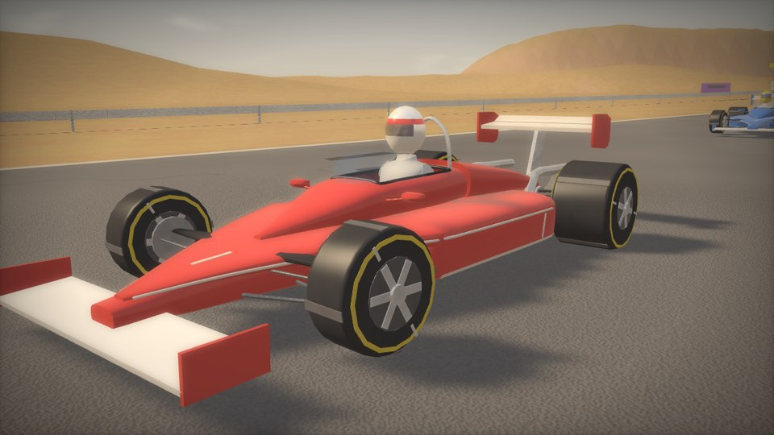 |
|  | 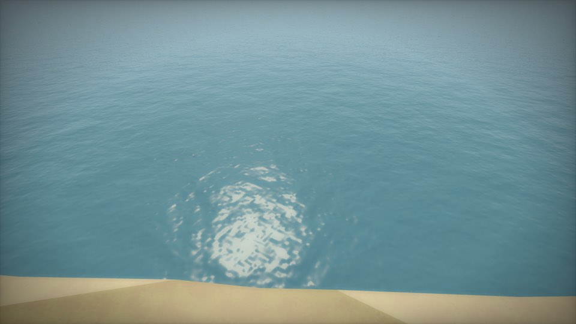 |
|  | 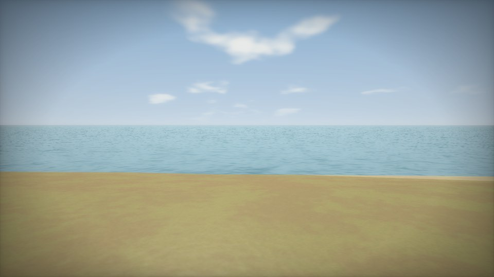 |
|  | 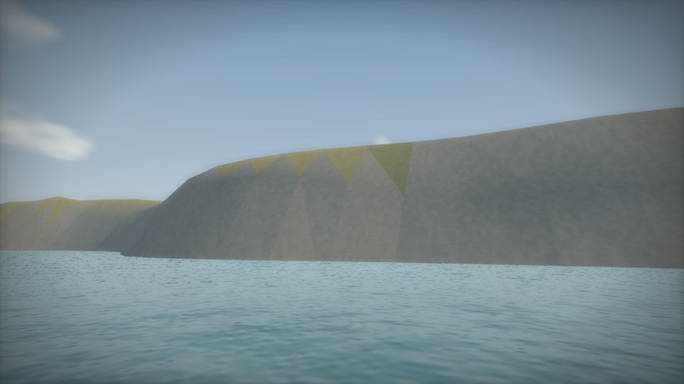 |
| 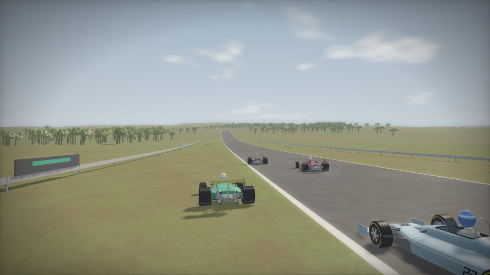 | 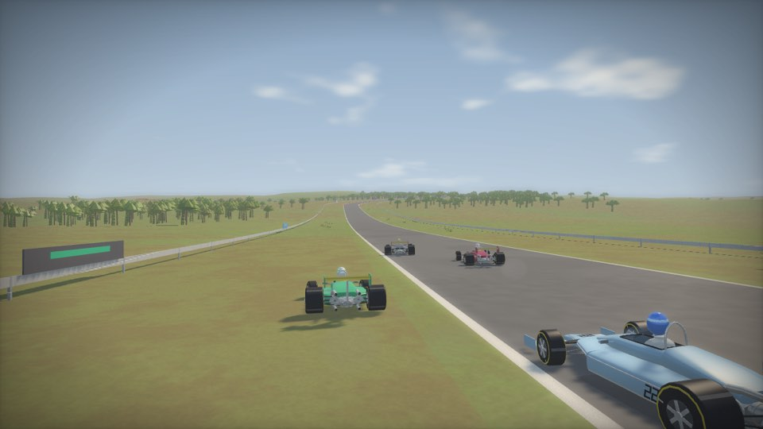 |

Contre-jour de Cap-Séquoia dans la maquette :
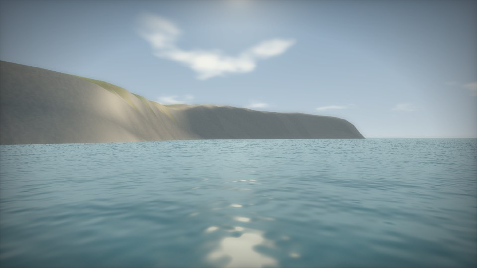

Ce que la maquette montre : la mer cesse d'être laiteuse, le reflet du soleil devient un chemin de reflets, le rouge
redevient rouge. Ce qu'elle ne règle pas : la brume plâtrée de Haut-Col
([avant](rapports/photo-2026-11-18/images/c2-bord.jpg), [maquette](rapports/photo-2026-11-18/images/c2-bord-maquette.jpg)),
la mer de nuit trop claire (palette de nuit, § 1.4), les aplats du terrain.

Pourquoi ne pas l'appliquer telle quelle :
- elle retouche une copie verrouillée commune à quatre jeux, sans option ;
- ses vagues coûtent 2,2 ms sur une mer plein écran ;
- son bruit de valeur laisse voir une grille dans les reflets du soleil ;
- l'herbe et le sable y sortent trop saturés ;
- les autres endroits de la courbe de tons (effets, foule, FSky, secours Canvas 2D) n'y sont pas.

## 7. Intégration

1. **FERRO (`M4D135/FERRO`)** : les options `tons`, `uExposition` (L2, qui corrige aussi § 2.3), `uCielSH`,
   `fx.contacts`, `fx.ombreProche`, `precalculerOmbre`, `fx.occlusionSol`, le calque d'eau et l'eau diélectrique,
   la brume selon l'altitude. Plus la correction du § 2.4. Chaque option a son test dans le dépôt FERRO, puis sa
   propagation par `tools/install-ferro.py` avec un nouveau `FERRO.lock.json`.
2. **BITUME** : `jeu.js` (ouverture des options, passage des voitures proches et de la boîte de la voiture filmée,
   sans allocation), `decor.js` (textures précalculées : occlusion, rivage), `ambiance.js` (direction du soleil au
   crépuscule, nuit sombre), `voiture.js` (occlusion par pièce, vernis), `traces.js` (gerbes). Chaque nouveau module
   ou précalcul a son test dans `verifications/` : déterministe à graine égale, aucun tirage dans le hasard de course,
   emprise et taille bornées.
3. **Qualification** : la suite complète, les mêmes cadrages avant et après (`outils/lot1.py` à `lot3.py`), le coût en
   séances alternées sur le Mac de David, l'indice de scintillement, et une passe en fenêtre visible (cadence réelle,
   `tools/profil-accrocs.mjs`).
4. **Dépendance au lot 5B** : les effets Fine qui coûtent des millisecondes (O4, L7, E4, E5) n'entrent qu'une fois les
   gains du 5B mesurés. Aujourd'hui, Fine rate une image sur quatre sur le Mac de David avec les rétroviseurs.

## 8. Questions pour David

1. Où as-tu vu les ombres scintiller le 16 novembre : circuit, vue, qualité Auto ou fixe, taille de la fenêtre ? Les
   deux scènes mesurées ne scintillent pas.
2. La courbe de tons qui garde la teinte change l'aspect de tous les circuits (rouge vraiment rouge, ciel plus
   profond). On l'applique partout ?
3. La nuit : vraiment sombre et contrastée, où phares et lampes comptent, ou la lisibilité actuelle ?
4. Le crépuscule : soleil bas et ombres longues, donc une direction du soleil qui change avec le moment ?
5. Un palier au-dessus de Fine (« Photo ») pour GTAO, le halo en pyramide, les rayons du soleil et le décor reflété
   dans l'eau, plutôt que d'alourdir Fine ?
6. Légère : y mettre les effets à coût nul (contact des voitures, courbe de tons, eau, occlusion du couvert), qui
   changent son image sans coût mesurable, ou la garder strictement identique ?
7. On commence par l'eau, le plus visible, ou par les ombres, ta demande du 16 novembre ?
8. L'écran noir de Légère avec MSAA 4× (§ 2.4) : correction dans le lot 5B, qui touche déjà FERRO, ou à part ?

## 9. Sources

- Ombres stables : Microsoft, « Cascaded Shadow Maps » et « Common Techniques to Improve Shadow Depth Maps »,
  https://msdn.microsoft.com/fr-fr/library/ee416307.aspx ; discussion de l'accrochage (Valient, ShaderX6),
  https://opengl.gamedev.net/forums/topic/707159-stable-cascaded-shadow-maps
- PCSS : R. Fernando, NVIDIA 2005,
  https://developer.download.nvidia.com/shaderlibrary/docs/shadow_PCSS.pdf ;
  https://http.download.nvidia.com/developer/presentations/2005/SIGGRAPH/Percentage_Closer_Soft_Shadows.pdf
- Ombres de contact : https://dev.epicgames.com/documentation/en-us/unreal-engine/contact-shadows-in-unreal-engine ;
  https://docs.unity3d.com/Packages/com.unity.render-pipelines.high-definition@16.0/manual/Override-Contact-Shadows.html
- GTAO : Jimenez, Wu, Pesce, Jarabo, « Practical Real-Time Strategies for Accurate Indirect Occlusion »,
  https://www.iryoku.com/downloads/Practical-Realtime-Strategies-for-Accurate-Indirect-Occlusion.pdf ;
  https://github.com/GameTechDev/XeGTAO
- Harmoniques sphériques : Ramamoorthi et Hanrahan 2001, https://graphics.stanford.edu/papers/envmap/
- Atmosphère : Hillaire 2020, https://diglib.eg.org/handle/10.1111/cgf14050 ; brume (Quilez),
  https://iquilezles.org/articles/fog/
- Exposition : https://dev.epicgames.com/documentation/en-us/unreal-engine/auto-exposure-in-unreal-engine ;
  https://docs.unity3d.com/Packages/com.unity.postprocessing@3.3/manual/Auto-Exposure.html
- Courbes de tons : Khronos PBR Neutral,
  https://gamedev.net/news/khronos-pbr-neutral-tone-mapper-released-for-true-to-life-color-rendering-of-3d-objects-r2733 ;
  comparaison, https://modelviewer.dev/examples/tone-mapping
- Halo : Jimenez, « Next Generation Post Processing in Call of Duty: Advanced Warfare », https://www.iryoku.com/?p=1707 ;
  https://learnopengl.com/Guest-Articles/2022/Phys.-Based-Bloom
- Cibles flottantes en WebGL 2 : https://web3dsurvey.com/webgl/extensions/EXT_color_buffer_half_float ;
  https://web3dsurvey.com/webgl2/extensions/EXT_color_buffer_float
- Eau : Finch, « Effective Water Simulation from Physical Models », GPU Gems,
  https://developer.nvidia.com/gpugems/gpugems/part-i-natural-effects/chapter-1-effective-water-simulation-physical-models ;
  absorption et écume, https://arycama.github.io/2021/02/13/physically-plausible-simplified-water-shading.html
- Pluie et surfaces mouillées : Tatarchuk 2006,
  https://advances.realtimerendering.com/s2006/Chapter3-Artist-Directable_Real-Time_Rain_Rendering_in_City_Environments.pdf ;
  série « Water drop » de S. Lagarde (2013), présentée sur https://3dvf.com/actualite-5676-sebastien-lagarde-simulation-pluie-en-jeu-video-html/ ;
  https://cescg.org/wp-content/uploads/2021/03/Nguyenova-Rendering-Wet-Roads-in-Driving-Simulations-1.pdf
- Scintillement spéculaire : Kaplanyan et al. 2016,
  https://developer.download.nvidia.com/gameworks/events/GDC2016/akaplanyan_specular_aa.pdf
- Rayons du soleil : Mitchell, GPU Gems 3, chapitre 13,
  https://developer.nvidia.com/gpugems/gpugems3/part-ii-light-and-shadows/chapter-13-volumetric-light-scattering-post-process
- Anticrénelage temporel : Salvi 2016,
  https://developer.download.nvidia.com/gameworks/events/GDC2016/msalvi_temporal_supersampling.pdf

Les sources ont été consultées par leurs résumés et extraits ; les articles complets n'ont pas tous été relus. Les
coûts du § 5 qui ne portent pas la mention « mesuré » sont des estimations à vérifier au premier prototype.
