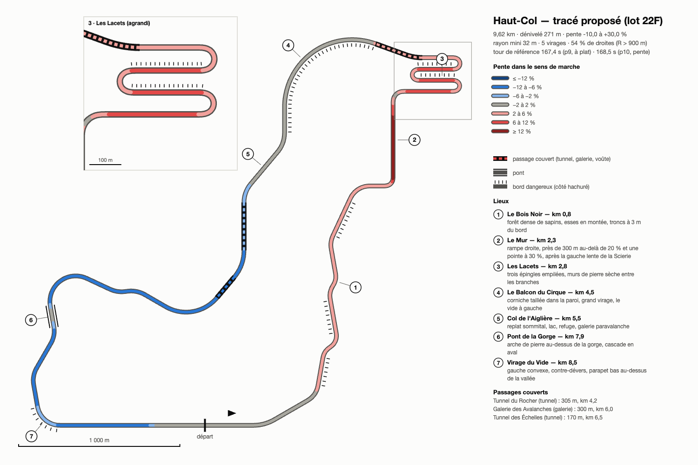
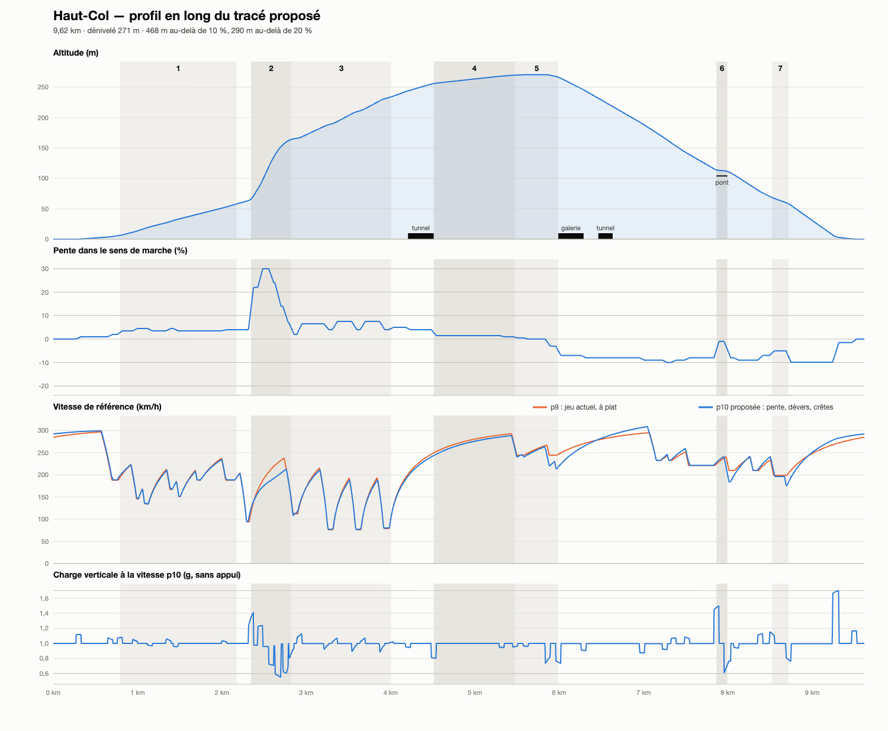

# Lot 22F — Des circuits mémorables

Date : **18 novembre 2026**. Statut : **bords de route prêts à intégrer** (module, vérifications, patch d'intégration) ;
**tracés, tunnels, caméras et physique p10 proposés**. Aucune source existante du jeu n'est modifiée par ce lot.

### Demandes de David du 18/11

- Relayée pour ce lot : « un peu plus de panneaux de publicité au bord de la route aussi, quelques bords de routes
  dangereux ».
- Consignées dans `AGENTS.md` (lot 22A) :
  - « haut col pente plus prononcée que 10% avec une partie en bord de falaise avec grand virage » ;
  - « une partie avec pente à 20 30 et circuit long, plus ballade agreable que circuit limite avec tunnels et joli
    paysage, dans les montages, passage en forent dense ».
- Consignée dans `AGENTS.md` (lots 22 et 21) : « plus de passage en tunnel, améliore eclairages dans tunnel, pas de
  clipping ».

### Cadre du lot 22F, fixé le même jour

- une identité et deux à quatre lieux exceptionnels par circuit ;
- le grand circuit de montagne dessiné sur Haut-Col, en 8 à 10 km ;
- pour chaque circuit, dire s'il faut redessiner le tracé ;
- régler les tunnels et les caméras qui traversent les parois.

### Décisions en vigueur qui encadrent ce lot (`AGENTS.md`, 18/11)

- **Les tracés restent.** « Les tracés en plan, les identifiants et les graines des sept circuits restent » (lot 22,
  suite). Pour Haut-Col, le lot 22A le redit : « le tracé en plan et la graine restent : c'est le relief et le terrain
  des abords qui changent ».
- **Le grand circuit de montagne n'est pas tranché.** Il faut encore choisir entre « refaire Haut-Col ainsi (son tracé
  de 5,2 km change alors, sous le même identifiant) ou en faire un nouveau circuit en gardant Haut-Col ».
- **Choix validés du lot 22** :
  - dénivelés par thème : côte 10 m, forêt 17 m, Islande 25 m, Asie 24 m, Pacifique 34 m, désert 45 m, montagne 50 m ;
  - pentes jusqu'à 10 % en montagne, plafond levé pour Haut-Col par le lot 22A ;
  - contre-dévers jusqu'à −2°, crêtes qui allègent de 0,4 g au plus ;
  - records et fantômes à zéro avec p10 ;
  - marques imaginaires tirées au hasard ;
  - un à deux passages couverts par circuit, et un second tunnel en montagne.

**Ce lot respecte** les bords (marques imaginaires sur un hasard propre), les passages couverts (un à trois par
circuit, un second tunnel en montagne), les contre-dévers, la remise à zéro avec p10 et l'objectif « pas de clipping ».

**Ce lot propose, contre les décisions en vigueur, et cela demande l'accord de David** :

- de nouveaux tracés en plan, alors que les tracés restent ;
- des dénivelés au-delà de ceux validés : Val-Brûlé 48 m au lieu de 17, Lande-Noire 34 au lieu de 25, Roche-Fauve 62
  au lieu de 45 (avec une rampe à 12 %), Brume-de-Jade 50 au lieu de 24, Cap-Séquoia 47 au lieu de 34 ;
- une crête du Mur à 0,45 g, au-dessus de la règle de 0,4 g ;
- le grand circuit de montagne dessiné comme un nouveau Haut-Col, avant que le choix soit fait.

Ces tracés sont donc des **propositions à juger**, pas un plan à exécuter. Le § 4 dit, circuit par circuit, ce qui
tient sur le tracé actuel.

## 0. En bref : fait, proposé, manquant

| Partie | État | Où |
|---|---|---|
| Publicités et bords dangereux | **Fait et vérifié** : `src/bords.js`, 7 vérifications. **Branché et vérifié dans le jeu** par `integration.patch` (non commité) : 15 vérifications, suite complète verte, captures, banc. | § 5, rapport |
| Tracés des sept circuits | **Proposés** dans un prototype hors du jeu (`tools/lieux-trace.mjs`, `tools/lieux-partitions.mjs`), 6 vérifications, plans et profils. Ils vont contre la règle « les tracés en plan restent » : décision de David requise. Trois sont à juger (Haut-Col, Val-Brûlé, Brume-de-Jade), quatre sont des brouillons. | § 2 à § 4 |
| Grand circuit de montagne, 9,6 km | **Proposé et essayé dans le vrai rendu** à la place de Haut-Col, par substitution du tracé avant chargement (captures, aucune erreur de page). Refaire Haut-Col ou créer un huitième circuit reste à trancher. Seul le tunnel du Rocher se bâtit ; galerie, second tunnel, pont, vide et parois attendent les sous-lots B, C et F. | § 3 |
| Tunnels multiples, caméras | **Proposés** à la lecture du code. Une seule correction faite, dans le patch : la caméra au sol de la démo se pose devant les murets au lieu d'être dedans. | § 6, § 7 |
| Physique p10 | **Exigences chiffrées** ; seule la vitesse de référence p10 existe, dans le prototype. | § 3.4 |
| Images par seconde sur le Mac | **Non mesurées.** Le banc du projet a tourné en rendu logiciel : seuls les appels de dessin et les triangles s'y comparent. | § 5.5 |

## 1. Ce que contient le lot

| Fichier | Rôle |
|---|---|
| [`src/bords.js`](../../src/bords.js) | Publicités et bords dangereux : plan déterministe, limites resserrées, pose dans les lots du décor. Le jeu ne le charge pas tant que le patch n'est pas appliqué. |
| [`verifications/bords.test.mjs`](../../verifications/bords.test.mjs) | 7 vérifications : plan identique d'une fois sur l'autre sans `Math.random`, 2 à 4 dangers, séries de 3 à 6 bandeaux, marques, limites en entonnoir, Légère < 0,7 × Fine à solides égaux, bords déclarés par un tracé repris. |
| [`tools/lieux-trace.mjs`](../../tools/lieux-trace.mjs) | Constructeur de tracés par partitions : le prototype de la génération 3 (§ 8). |
| [`tools/lieux-partitions.mjs`](../../tools/lieux-partitions.mjs) | Les sept partitions : lieux, séquences, pentes, dévers, passages couverts, ponts, bords. Données pures, sérialisables. |
| [`verifications/lieux-traces.test.mjs`](../../verifications/lieux-traces.test.mjs) | 6 vérifications : fermeture et contrôles, même tracé à chaque construction, exigences de Haut-Col, Spirale de Brume-de-Jade, lecture par les fonctions du jeu. |
| [`tools/lieux-plans.mjs`](../../tools/lieux-plans.mjs) | Plans et profils SVG et PNG, mesures JSON. |
| [`tools/lieux-captures.mjs`](../../tools/lieux-captures.mjs) | Captures dans le vrai rendu : bords du catalogue, ou tracé proposé substitué avant le chargement (`--trace haut-col --vues lieux`). |
| [`rapports/lieux-2026-11-18/`](rapports/lieux-2026-11-18/) | Plans, profils, mesures, captures, banc, `integration.patch`. |

Essayer les bords dans le jeu :

```bash
git apply docs/reprise/rapports/lieux-2026-11-18/integration.patch
python3 construire.py
for t in verifications/*.test.mjs; do node "$t" > /dev/null 2>&1 || echo "ECHEC $t"; done
node tools/lieux-captures.mjs dist/bitume.html --vues bords --sortie <dossier>
```

Le patch touche trois fichiers et en ajoute un :

- `construire.py` charge `bords.js` avant `decor.js` ;
- `src/decor.js` établit le plan, retire la glissière derrière les parapets, murets et fossés, et pose les objets dans des lots à part, après tous les autres ;
- `src/jeu.js` resserre les limites à la création du circuit et tient la caméra au sol devant les murets ;
- `verifications/bords-integration.test.mjs` est ajouté (15 vérifications).

Pour revenir en arrière : `git apply -R` du même patch, puis `git checkout -- dist VERSION.json SIZE.json`.

Seul `src/scene-bench.js` crée un circuit sans passer par `jeu.js`. Cette scène sert à la détection de la qualité :
elle rendra les bords, sans limites resserrées. C'est sans effet sur une course ; sa charge devient simplement celle
d'une vraie course.

## 2. Les sept circuits : vue d'ensemble

| Circuit | Caractère | Aujourd'hui | Proposé (tour p9, p10) | Faut-il un nouveau tracé ? |
|---|---|---|---|---|
| Val-Brûlé | forêt | 4 222 m, 12 m de dénivelé, tour 81,0 s | 4 126 m, 48 m, −7 à +5 %, 75,3 s · 75,6 s | Seulement pour les deux épingles de la Cascade ; le reste tient sur le tracé actuel |
| Port-Sable | côte | 3 638 m, 10 m, 75,6 s | 4 388 m, 10 m, −4,5 à +3 %, 79,2 s · 79,1 s | Seulement pour le Môle (aller et retour) ; brouillon |
| Haut-Col | montagne | 5 216 m, 13 m, 87,3 s, un tunnel de 260 m | 9 618 m, 271 m, −10 à +30 %, 167,4 s · 168,5 s | À trancher : refaire Haut-Col, ou créer un huitième circuit et garder Haut-Col |
| Lande-Noire | Islande | 4 616 m, 13 m, 84,9 s | 4 624 m, 34 m, −4 à +4,4 %, 73,6 s · 73,5 s | Pas nécessaire : ses lieux tiennent sur le tracé actuel |
| Roche-Fauve | désert | 4 834 m, 27 m, 95,8 s | 4 698 m, 62 m, −9 à +12 %, 74,9 s · 76,4 s | Pas nécessaire (l'allée y ferait 450 m au lieu de 700) |
| Brume-de-Jade | Asie | 5 018 m, 25 m, 97,3 s | 4 762 m, 50 m, −5 à +4 %, 84,0 s · 83,9 s | Seulement pour la Spirale, qui se croise elle-même |
| Cap-Séquoia | Pacifique | 5 234 m, 13 m, 99,9 s | 5 872 m, 47 m, −3 à +6,5 %, 91,7 s · 91,6 s | Pas nécessaire, mais la corniche y serait faite de droites et d'épingles |

Le tour indiqué est celui de la vitesse de référence : celle du jeu (p9) pour les tracés actuels, p9 puis p10 (§ 3.4)
pour les tracés proposés. Plans, profils et mesures de chaque proposition :
`rapports/lieux-2026-11-18/<id>-plan.png`, `<id>-profil.png`, `<id>.json` et `mesures.json`.

**Par défaut, les tracés restent** (décision du lot 22) : les lieux se posent alors sur le tracé actuel, par le relief, le
terrain et le décor. Un nouveau tracé n'est indispensable que pour quatre choses, qui demandent l'accord de David :

- les deux épingles côte à côte de la Cascade (Val-Brûlé) ;
- l'aller et retour sur le Môle (Port-Sable) ;
- la Spirale, qui passe sous sa propre route (Brume-de-Jade) ;
- le grand circuit de montagne de 8 à 10 km.

**Ce que permettent les tracés actuels** :

- **droites** de 388 à 592 m ; la plus longue est à Lande-Noire (592 m) ;
- **virages lents** : 3 à 7 par circuit, de 26 à 68 m de rayon ;
- **longues courbes de plus de 150 m** : seulement trois, à Val-Brûlé (79 m de rayon), à Haut-Col (157 m de rayon sur
  156 m, à 3 838 m) et à Roche-Fauve (280 m de rayon).

La corniche de Haut-Col demandée au lot 22A, « tracé en plan conservé », irait donc sur cette courbe de 157 m et sur les
droites qui l'encadrent.

### Ce que la comparaison apprend

- **Les tracés actuels se ressemblent.** `circuit.js` tire un polygone étoilé de 7 à 11 sommets et en arrondit les
  coins : 75 à 87 % de droites, 3 à 7 virages de moins de 70 m, 10 à 27 m de relief. Haut-Col, le circuit de montagne,
  n'a que 13 m de dénivelé et 2,8 % de pente en montée.
- **Les partitions racontent le tour** : une suite de séquences voulues (« la Scierie, puis le Mur, puis trois
  lacets »). On y trouve 48 à 67 % de droites et de longues courbes, mais seulement 0 à 5 virages de moins de 70 m.
- **Les brouillons sont donc plus rapides** : 197 à 231 km/h de moyenne, contre 173 à 215 km/h aujourd'hui.
  Roche-Fauve n'a plus aucun virage lent ; Lande-Noire, Brume-de-Jade et Cap-Séquoia n'en ont qu'un. Pour garder du
  freinage, il faudrait resserrer le Kopje, les Geysers et la sortie du Bosquet.
- **Tous les tracés passent les contrôles du jeu.** Rayon d'au moins 24 m. Au moins 60 m entre deux portions de piste.
  Un seul croisement, déclaré : la Spirale, avec 14,85 m d'écart vertical. Charge verticale entre 0,55 et 1,70 g. Ligne
  des stands d'au moins 140 m.
- **Les identifiants restent** (`val-brule` … `cap-sequoia`), ainsi que les noms, les graines et les thèmes.
  Records et fantômes sont rangés sous la clé de la physique (`bitume.records.p9`, `bitume.fantome.p9.<id>`). Passer à
  p10 les remet donc tous à zéro d'un coup, comme le prévoient les choix validés du lot 22. Cela couvre aussi un
  éventuel nouveau tracé.
- **Si un tracé change sans passer à p10**, il faut une clé par version de tracé. Le fantôme se protège déjà par sa
  longueur ; le record, non.
- **Environ 25 vérifications existantes figent l'ancien tracé** : elles citent Haut-Col, son tunnel ou le thème
  montagne (`tunnel.test`, `tunnel-transitions.test`, `circuit.test`, `stands.test`, `decor*.test`…). Un redessin
  passe par une revue de leurs valeurs.

## 3. Haut-Col en détail





### 3.1 Identité

**La grande boucle du cirque de l'Aiglière.** Le tour dure 2 min 48 s :

1. on part de la vallée et on monte par la forêt ;
2. on attaque le Mur, puis on empile trois lacets ;
3. on traverse le rocher et on longe le cirque en corniche ;
4. on passe le col ;
5. on redescend par la galerie, le tunnel des Échelles, l'alpage et la gorge.

C'est le circuit le plus long du catalogue, avec 9,6 km et 271 m de dénivelé. Il tourne dans le sens contraire des
aiguilles d'une montre, le cirque à l'intérieur de la boucle.

**Deux voies, à trancher par David (lot 22A).**

- **Refaire Haut-Col ainsi.** Le tracé de 5,2 km disparaît sous le même identifiant, et la graine du décor reste.
- **Créer un huitième circuit de montagne avec ce tracé, et garder Haut-Col.** Haut-Col reçoit alors ce que demande
  la première demande du 18/11 :
  - des rampes au-delà de 10 % ;
  - une corniche sur la courbe de 157 m à 3 838 m, paroi d'un côté et vide de l'autre ;
  - le second tunnel des choix validés ;
  - le tout sur son tracé actuel.

Le prototype sert les deux voies : la partition ne dépend ni de l'identifiant ni de la place au catalogue.

### 3.2 Le tour

| km | Lieu | Ce qu'on y fait | Pente | Vitesse p10 |
|---|---|---|---|---|
| 0 – 0,8 | Vallée, stands | ligne droite, départ | 0 à 2 % | 189 – 300 km/h |
| 0,8 – 2,2 | ① Le Bois Noir | esses en montée dans les sapins ; troncs à 2,6 – 6 m du bord sur trois portions | 3,5 – 4,5 % | 134 – 235 |
| 2,2 – 2,3 | La Scierie | gauche de 45 m au pied du Mur | 4 % | 95 à la corde |
| 2,3 – 2,8 | ② Le Mur | 110 m à 22 %, 130 m à 30 %, 80 m à 24 %, bascule à 14 puis 7 % ; 98 m de montée en 480 m | 22 – 30 % | 124 → 174 (à 30 %) → 204 (crête) → 139 |
| 2,8 – 4,0 | ③ Les Lacets | trois épingles de 32 – 34 m, branches de 230 m, murets de pierre | 4 – 7,5 % | 76 – 211 |
| 4,2 – 4,5 | Tunnel du Rocher | 305 m dans une courbe de 300 m | 4 % | 197 – 243 |
| 4,5 – 5,5 | ④ Le Balcon du Cirque | corniche de 420 m de rayon sur 110°, vide à gauche, parapet, dévers −2,5° | 1 – 1,5 % | 243 – 289 |
| 5,5 – 6,0 | ⑤ Col de l'Aiglière | replat à 270 m, lac, refuge | 0 % | 214 – 263 |
| 6,0 – 6,3 | Galerie des Avalanches | 300 m, ouverte à gauche sur le cirque | −7 % | 218 – 264 |
| 6,5 – 6,6 | Tunnel des Échelles | 170 m droit | −8 % | 280 – 291 |
| 6,6 – 7,9 | L'Alpage | traversée rapide en balcon au-dessus de la vallée | −8 à −10 % | 221 – 309 (pointe du tour) |
| 7,9 – 8,0 | ⑥ Pont de la Gorge | arche de pierre, cascade en aval | −1 % | 203 – 241 |
| 8,5 – 8,7 | ⑦ Virage du Vide | gauche de 140 m en contre-dévers (2°), vide à droite, parapet bas | −5 % | 176 – 225 |
| 8,7 – 9,6 | Vallée | descente le long de la rivière | jusqu'à −10 % | 183 – 292 |

### 3.3 Relief

- **Montées et descentes.** 3,7 km montent de plus de 2 % et 3,4 km descendent. 468 m dépassent 10 % ; les 290 m qui
  dépassent 20 % sont tous dans le Mur. La descente la plus raide est à −10 % (alpage et vallée).
- **La pente forte se monte, elle ne se descend pas.** C'est voulu : à −25 %, la distance de freinage augmenterait de
  22 % (§ 3.4).
- **Raccords verticaux.** Ce sont des paraboles dimensionnées par la vitesse : 0,4 g d'allègement au plus sur une crête
  (le prototype tolère 0,5 g), 0,7 g d'écrasement au plus dans un creux.
- **Sommet du Mur** (2 698 m) : la charge tombe à 0,55 g à 204 km/h, sur un rayon vertical de 742 m. Les 0,45 g
  d'allègement dépassent la règle d'un vingtième : il faut allonger la bascule d'environ 80 m (rayon de 820 m).
- **Pied du Mur** : 1,24 g, sur un rayon de 335 m à 102 km/h.
- **Charge maximale du tour** : 1,70 g, dans le creux de la vallée (9 313 m).

### 3.4 Exigences physiques p10 pour 20 à 30 %

La physique applique déjà la gravité le long de la pente et du dévers (`conduite.js`, `gT` et `gN`). Le tableau chiffre
ce que la pente change, avec les constantes de la vitesse de référence du jeu : poussée de `circuit.js`, freinage de
16 m/s², 310 km/h de pointe à plat, 10,9 m/s² d'accélération à 70 km/h.

| Pente | θ | g·sin θ | Adhérence (cos θ) | Accélération à 70 km/h | Vitesse d'équilibre en montée | Freinage en montée | Freinage en descente |
|---|---|---|---|---|---|---|---|
| 20 % | 11,3° | 1,92 m/s² | −2 % | 9,0 m/s² (−18 %) | 250 km/h | 17,6 m/s², distance −9 % | 13,8 m/s², distance +16 % |
| 25 % | 14,0° | 2,38 m/s² | −3 % | 8,5 m/s² (−22 %) | 238 km/h | 17,9 m/s², −11 % | 13,1 m/s², +22 % |
| 30 % | 16,7° | 2,82 m/s² | −4 % | 8,1 m/s² (−26 %) | 227 km/h | 18,1 m/s², −12 % | 12,5 m/s², +28 % |

Ce que p10 doit ajouter (lot physique, non fait) :

1. **Charge statique en m·g·cos θ·cos β** au lieu de m·g. Elle sert aux charges des essieux (`fzAv`, `fzAr`) et au
   freinage (`fFrein`).
2. **Charge de relief m·v²·κv**, où κv est la courbure verticale du profil, négative sur une crête. La voiture
   s'allège de 0,45 g en haut du Mur et s'écrase de 0,24 g à son pied.
3. **Garde au décollage.** Sous 10 % du poids (appui compris), les roues ne guident plus et l'état « en l'air » de
   `conduite.js` prend le relais. Le tracé garantit cette marge à la vitesse de référence : v ≤ √(0,9·g·cos θ / −κv).
4. **Motricité en montée.** Le transfert de charge dû à la pente vaut m·g·sin θ·h/L vers l'arrière, soit environ 3 %
   du poids à 30 % (h = 0,33 m, empattement 2,85 m). Le transfert actuel ne vient que des accélérations des pneus. En
   sortie de Scierie, en première ou en deuxième, la voiture doit pouvoir patiner si l'on écrase l'accélérateur.
5. **Vitesse de référence p10**, pour les rivaux, le réalisateur et le temps de référence. Il s'agit de `vitessesP10`
   (`tools/lieux-trace.mjs`) : adhérence en cos θ et en κv, garde de crête, freinage et poussée corrigés de la gravité.
   Sans elle, les rivaux freinent trop tard en descente et trop tôt en montée. Écart mesuré sur Haut-Col :
   - au point à 30 %, 174 km/h au lieu de 188 ;
   - dans le Mur, 9,83 s au lieu de 9,19 s ;
   - sur le tour, +1,15 s.
6. **Validation.** `valider` refuse aujourd'hui toute pente au-delà de 7 %. Elle doit l'accepter dans une portion
   déclarée « rampe » : le Mur, et la rampe du Canyon à 12 % si David la garde. Ailleurs, elle applique les plafonds
   validés (10 % en montagne).
7. **Records et fantômes** passent sous la clé `p10`.

### 3.5 Bords, forêt, points de vue

- **Bords déclarés par la partition** :
  - Sapins du Bois Noir : à droite de 790 à 970 m, à gauche de 1 146 à 1 366 m, à droite de 1 766 à 2 026 m ;
  - Murs des Lacets : à droite de 3 339 à 3 569 m, à gauche de 3 670 à 3 900 m ;
  - Balcon du Cirque : vide à gauche de 4 511 à 5 478 m, soit près d'un kilomètre ;
  - Virage du Vide : vide à droite de 8 523 à 8 719 m.
- **Forêt dense** : le Bois Noir, sur 1,4 km d'esses, avec des troncs à 2,6 – 6 m du bord. Un écart s'y paie contre un
  arbre.
- **Points de vue** :
  - le Balcon, d'où l'on voit le cirque en contrebas et, en face, le Mur et les Lacets ;
  - le Col, avec le lac et la descente ;
  - le Pont de la Gorge, avec la cascade ;
  - le Virage du Vide, au-dessus de la vallée et des stands.
- **Trois passages couverts** : voir § 6.

### 3.6 Ce qui se voit déjà dans le vrai rendu

Planche : [`captures/haut-col-trace-planche.jpg`](rapports/lieux-2026-11-18/captures/haut-col-trace-planche.jpg),
avec la liste des vues dans `captures/trace-haut-col.json`. Le tracé proposé est substitué avant le chargement ; le
décor actuel est bâti autour.

- **Le Mur** se lit comme une rampe raide qui monte dans le ciel (`haut-col-lieu-2-le-mur.jpg`).
- **Les Lacets** se lisent en survol : trois épingles empilées (`haut-col-survol-3-les-lacets.jpg`).
- **Le tunnel du Rocher** est bâti, avec son portail et sa colline de blocs (`haut-col-couvert-tunnel-du-rocher.jpg`).
- **Le Bois Noir** montre l'allée de sapins, ses bandes blanches et l'ombre portée
  (`haut-col-bord-sapins-du-bois-noir-1146.jpg`).
- **Ce qui n'est pas bâti** :
  - la Galerie des Avalanches et le tunnel des Échelles, car le jeu ne sait bâtir qu'un tunnel ;
  - le Pont de la Gorge, car il n'existe ni pont ni gorge ;
  - le vide du Balcon et du Virage du Vide : parapet et balises sont posés, mais le terrain reste plat derrière.
- **Le terrain doit suivre le tracé (sous-lot C).** Le terrain du thème montagne ne connaît pas ces 271 m de relief.
  Recalé dessus, il dresse de grandes parois grises de part et d'autre de la piste. Au-dessus de 250 m (Balcon, Col),
  la couleur de neige du thème (`decor.js`, au-dessus de 250 + 40·tache m) dessine des taches blanches en dents de scie.

### 3.7 Ce qu'on en retient

**Le Mur**, une rampe à 30 % qu'on voit monter dans le ciel ; **les Lacets** empilés ; **le Balcon**, une corniche
avalée à 290 km/h le long du vide.

## 4. Les six autres circuits

Les captures de cette section viennent des **tracés actuels**, avec les bords branchés. Les lieux proposés n'existent
qu'en plan.

### 4.1 Val-Brûlé — forêt (graine 11)

**Identité.** Un val forestier autour d'un lac : un circuit de campagne fluide qui monte doucement vers une cascade et
redescend par un versant brûlé.

**Lieux** (abscisses du tracé proposé) :

| Lieu | Abscisses | Ce qu'on y voit |
|---|---|---|
| ① Lac du Moulin | 0 – 557 m | stands au bord de l'eau, moulin, pont de pierre sur le déversoir |
| ③ La Futaie | 867 – 1 252 m | voûte de hêtres fermée sur 200 m, rais de lumière |
| ② La Cascade | 1 889 – 2 342 m | deux épingles de 34 m au pied et au flanc de la chute, rochers à gauche, chaussée humide |
| ④ Le Brûlis | 2 844 – 3 389 m | versant brûlé, vue sur tout le val, descente à 7 % avec le vide à gauche |

**Tracé.** 4 126 m, 48 m de dénivelé, rayon mini 34 m, 63 % de droites, deux virages lents.

**Bords.**

- Aujourd'hui, avec le patch : un fossé à droite à 513 m, des allées d'arbres à gauche à 1 172 m, à droite à 1 724 m et
  à gauche à 2 846 m. 65 bandeaux en 16 séries (15,4 au km), 3 grands panneaux.
- Dans le tracé proposé : les hêtres de la Futaie, les rochers de la Cascade, le rebord du Brûlis.

**Passages.** La Voûte des Hêtres (végétale : ni murs ni abri) et le Pont du Moulin.

**Ce qu'on en retient.** La Cascade, deux épingles dans les embruns.

**Nouveau tracé ?** Seulement pour la Cascade : ses deux épingles côte à côte n'existent pas dans le polygone actuel.
Le tracé actuel compte quatre virages lents de 32 à 57 m et des droites de 342 à 412 m. On peut y mettre le lac le long
de la ligne des stands, la Futaie sur une droite, le Brûlis sur une descente, et la Cascade au pied d'un seul virage
lent. Le dénivelé proposé (48 m) dépasse les 17 m validés pour la forêt : il faut le ramener, sauf accord de David.

### 4.2 Port-Sable — côte (graine 29)

**Identité.** Un port de pêche et des salins. Tout plat, rapide, venteux, et le circuit le plus couvert de publicités
(densité × 1,5).

**Lieux** :

| Lieu | Abscisses | Ce qu'on y voit |
|---|---|---|
| ① Le Grand Môle | 280 – 1 129 m | aller et retour sur la digue, épingle de 32 m autour du phare, la mer à gauche puis à droite |
| ② Les Salins | 1 485 – 1 845 m | digue droite entre les bassins roses, de l'eau des deux côtés |
| ③ Le Cordon dunaire | 2 033 – 2 543 m | dos-d'âne sans visibilité, sable sur les bas-côtés, ganivelles |
| ④ Pont du Canal | 3 968 – 4 128 m | pont tournant à poutres d'acier : on passe sous le treillis |

**Tracé.** 4 388 m, 10 m de dénivelé, rayon mini 32 m, trois virages lents.

**Bords.**

- Aujourd'hui : un vide à gauche à 1 302 m et un muret à droite à 1 957 m (`port-sable-danger-muret-d-1957-portion.jpg`).
  99 bandeaux en 22 séries (27,2 au km), 4 grands panneaux, aucun solide ajouté.
- Dans le tracé proposé : les quais du Môle (vide à gauche puis à droite) et les fossés des Salins des deux côtés.

**Passage.** Le Pont du Canal (treillis) : ombres rayées, aucun abri.

**Ce qu'on en retient.** Le Môle et son phare : le circuit va au bout de la digue et revient.

**Nouveau tracé ?** Seulement pour l'aller et retour du Môle. Le tracé actuel compte cinq virages lents et des droites
de 348 à 388 m. On peut y mettre les Salins sur une droite, le Cordon dunaire en dos-d'âne (dans les 10 m de dénivelé
validés) et le Pont du Canal. Le reste du brouillon ressemble encore à un grand polygone.

### 4.3 Lande-Noire — Islande, plateau volcanique (graine 83)

**Identité.** Un plateau minéral, de la lave noire, de la vapeur. Presque pas de publicité (densité × 0,45).

**Lieux** :

| Lieu | Abscisses | Ce qu'on y voit |
|---|---|---|
| ③ La Coulée | 417 – 847 m | tranchée dans la lave noire, blocs au bord des deux côtés, fissure rougeoyante la nuit |
| ② Les Geysers | 1 297 – 2 123 m | plateau fumant, la vapeur traverse la piste, un geyser jaillit à heure fixe |
| ④ Virage de la Cascade | 2 818 – 2 914 m | épingle de 50 m au-dessus des orgues de basalte, le vide à droite |
| ① La Faille | 3 034 – 3 658 m | la piste au fond d'un rift entre deux murs de basalte (limites à 8,5 m), pont sur une fissure d'eau claire |

**Tracé.** 4 624 m, 34 m de dénivelé, rayon mini 50 m, un seul virage lent.

**Bords.**

- Aujourd'hui : un fossé à gauche à 1 620 m, des rochers à gauche à 2 225 m et à 2 833 m, un vide à droite à 3 582 m.
  62 bandeaux en 16 séries (13,4 au km), 6 grands panneaux.
- Dans le tracé proposé : les blocs de la Coulée, le rebord de la Cascade, les murs de la Faille.

**Passage.** Le Tube de lave : 250 m de tunnel naturel en légère courbe, éclairé par ses trous de voûte.

**Ce qu'on en retient.** La Faille.

**Nouveau tracé ?** Pas nécessaire. Sur le tracé actuel :

- la Faille va sur la droite de 592 m qui part à 412 m, la Coulée sur celle de 562 m ;
- le Tube de lave et les Geysers trouvent leur place ;
- la Cascade va sur l'un des virages lents (31 à 68 m).

Le brouillon, proche d'un grand polygone, n'apporte rien de plus. Le dénivelé proposé (34 m) dépasse les 25 m validés
pour l'Islande.

### 4.4 Roche-Fauve — Afrique, hauts plateaux d'ocre (graine 107)

**Identité.** De grandes lignes droites, un canyon, des boules de granit et la chaleur.

**Lieux** :

| Lieu | Abscisses | Ce qu'on y voit |
|---|---|---|
| ③ L'Allée des Baobabs | 583 – 1 271 m | 700 m droits entre les baobabs, le soleil couchant dans l'axe |
| ① L'Arche | 1 439 – 1 602 m | arche de grès rouge, 40 m au-dessus de la piste, vue de loin depuis l'allée |
| ② Le Canyon | 1 602 – 2 321 m | descente à 9 % entre les strates, radier dans l'oued, rampe de sortie à 12 % |
| ④ Le Kopje | 3 038 – 3 331 m | esses entre les boules de granit, rochers à 3 m du bord |

**Tracé.** 4 698 m, 62 m de dénivelé, rayon mini 70 m, aucun virage lent. Le passage à p10 coûte 1,4 s au tour, à cause
de la rampe à 12 %.

**Bords.**

- Aujourd'hui : des rochers à droite à 757 m (`roche-fauve-danger-rochers-d-757-travers.jpg`) et à gauche à 2 203 m,
  un fossé à droite à 2 727 m. 72 bandeaux en 18 séries (14,9 au km), 7 grands panneaux.
- Dans le tracé proposé : les parois du Canyon et les boules du Kopje.

**Passage.** L'Arche : 80 m d'ombre, sans murs.

**Ce qu'on en retient.** L'Allée des Baobabs qui file vers l'Arche.

**Nouveau tracé ?** Pas nécessaire. Sur le tracé actuel :

- l'Allée des Baobabs va sur la droite de 454 m (au lieu de 700), avec l'Arche au bout ;
- le Canyon va sur la courbe de 280 m ;
- le Kopje va sur l'enchaînement de six virages lents de 31 à 66 m.

Le dénivelé proposé (62 m) et la rampe à 12 % dépassent les 45 m validés pour le désert. Il faut les ramener, ou les
faire valider avec p10 et une validation élargie.

### 4.5 Brume-de-Jade — Asie, pics calcaires et terrasses (graine 131)

**Identité.** Des rizières en terrasses, des pitons calcaires, de la brume. Un circuit sinueux et étagé, qui fait 720°
de virage dans le tour : il tourne deux fois sur lui-même.

**Lieux** :

| Lieu | Abscisses | Ce qu'on y voit |
|---|---|---|
| ① Les Terrasses | 339 – 1 030 m | courbes de niveau à travers les rizières, murets, miroirs d'eau au printemps |
| ② Pont du Vent et de la Pluie | 1 491 – 1 591 m | pont couvert de bois, galerie ouverte sur la rivière |
| ③ La Grotte | 1 654 – 1 907 m | tunnel naturel, stalactites, lanternes de couleur |
| ④ La Spirale | 2 107 – 2 699 m | boucle de 270° autour du piton du temple ; on repasse 14,85 m sous l'approche |

**Tracé.** 4 762 m, 50 m de dénivelé, rayon mini 60 m, 48 % de droites (le plus sinueux des sept).

**Bords.**

- Aujourd'hui : des arbres à gauche à 1 540 m, des murets à droite à 2 628 m et à 3 331 m. 115 bandeaux en 26 séries
  (22,9 au km), 8 grands panneaux.
- Dans le tracé proposé : les murets des Terrasses et le bord de la Spirale.

**Passages.** Le pont couvert (100 m) et la Grotte (253 m).

**Ce qu'on en retient.** La Spirale, qui passe sous sa propre route.

**Nouveau tracé ?** Seulement pour la Spirale, qui demande aussi le sous-lot F (croisement à deux niveaux). Le tracé
actuel compte sept virages lents et des droites de 438 à 476 m : on peut y mettre les Terrasses sur un enchaînement de
virages, le pont couvert et la Grotte. Le dénivelé proposé (50 m) dépasse les 24 m validés pour l'Asie.

### 4.6 Cap-Séquoia — États-Unis, falaises du Pacifique (graine 157)

**Identité.** Une forêt de séquoias géants au-dessus des falaises de l'océan.

**Lieux** :

| Lieu | Abscisses | Ce qu'on y voit |
|---|---|---|
| ① Bosquet des Géants | 260 – 1 440 m | esses entre les troncs, passage sous le Tronc couché |
| ④ Tunnel de la Pointe | 3 227 – 3 606 m | on entre dans la roche face à la forêt, on sort face à l'océan |
| ② Corniche du Pacifique | 3 606 – 4 829 m | 1,2 km en balcon au-dessus de l'océan, muret bas, contre-dévers |
| ③ Pont de l'Anse | 4 829 – 5 049 m | arc de béton ajouré au-dessus de l'embouchure, la plage 60 m plus bas |

**Tracé.** 5 872 m, 47 m de dénivelé, rayon mini 65 m, un virage lent.

**Bords.**

- Aujourd'hui : un muret à droite à 1 429 m, des arbres à gauche à 2 789 m (`cap-sequoia-danger-arbres-g-2789-portion.jpg`),
  un vide à gauche à 4 524 m (`cap-sequoia-danger-vide-g-4524-approche.jpg`). 119 bandeaux en 27 séries (22,7 au km),
  10 grands panneaux, la passerelle (`cap-sequoia-passerelle-220.jpg`).
- Dans le tracé proposé : les troncs des Géants et la corniche (vide à gauche sur 1,2 km).

**Passages.** Le Tronc couché (50 m) et le Tunnel de la Pointe (190 m).

**Ce qu'on en retient.** La sortie du tunnel sur la corniche, face à l'océan.

**Nouveau tracé ?** Pas nécessaire. Le tracé actuel compte cinq virages lents, des droites de 396 à 426 m et aucune
courbe longue. On peut y mettre le Bosquet sur les virages lents, le Tunnel de la Pointe sur une droite, la corniche le
long de la côte (en droites et en virages) et le pont. Le terrain du thème fait déjà des falaises sur la côte, et la
corniche peut s'y appuyer. Le dénivelé proposé (47 m) dépasse les 34 m validés pour le Pacifique.

## 5. Bords de route

### 5.1 Publicités (« un peu plus »)

**Hasard propre au circuit.** La graine des bords est dérivée de celle du circuit (`graineBords`). Elle ne touche ni au
hasard du décor ni à celui de la course, et `Math.random` n'est jamais appelé. Le plan est calculé une fois et rangé sur
le circuit, sous une propriété non énumérable.

**24 marques imaginaires**, ni tabac ni alcool : BRAVELIN, CARBOLÈNE, VIRAGEX, MARMOTTE, OCRANE, GRIFFAL… Chaque circuit
en affiche 8 à 12. L'identité visuelle découle du nom : fond, bande, emblème (cinq formes), faux lettrage en barres.
Une marque a donc la même allure partout, et aucune image ni aucun texte n'est embarqué.

**Bandeaux.**

- Ils sont posés sur les glissières (segments de 8 m), sur les droites et les courbes de plus de 300 m de rayon.
- Ils vont par séries de 3 à 6 bandeaux d'une même marque, avec une chance de 7 % × densité par segment libre. Après
  une série, 80 à 190 m restent sans bandeau.
- Il n'y en a jamais sur la ligne des stands, dans un passage couvert, sur un pont ou le long d'un bord dangereux.
- Une série enjambe le panneau isolé historique (un segment sur neuf) sans le déplacer.
- Densité selon le caractère du lieu : côte × 1,5 ; forêt et Asie × 1 ; montagne, désert et Pacifique × 0,8 ; Islande
  × 0,45.

**Grands panneaux sur pieds** (7 × 2,8 m), derrière la glissière des droites de 300 m ou plus. Il y en a un tous les
220 à 300 m, en alternant les côtés, jamais du côté d'un bord dangereux.

**Une passerelle publicitaire** enjambe la piste 120 m avant la fin de la ligne droite des stands.

### 5.2 Bords dangereux (« quelques »)

**Nombre et place.** Deux à quatre portions par circuit, à 500 m au moins l'une de l'autre. Il n'y en a ni dans les
stands, ni dans les passages couverts, ni sur les ponts (marge de 80 m).

**Choix sur les tracés actuels** :

- **Candidats** : les courbes rapides (rayon de 100 à 600 m, de 50 m avant à 30 m après, entre 120 et 260 m de long) et
  le milieu des droites de 260 m ou plus (200 m).
- **Le vide** se met seulement à l'extérieur d'une courbe ; sinon, un muret le remplace.
- **Jamais devant un virage de moins de 95 m** : le décor y pose ses murs de pneus.
- **Ordre des types selon le lieu** :
  - forêt : arbres, fossé, arbres ;
  - côte : vide, muret, fossé ;
  - montagne : vide, rochers, muret ;
  - Islande : rochers, vide, fossé ;
  - désert : rochers, fossé, rochers ;
  - Asie : muret, vide, arbres ;
  - Pacifique : vide, arbres, muret.

**Sur un tracé de génération 3**, les bords viennent de la partition (`c.bords`) : ils sont là où le lieu les justifie.

**Ce qui les annonce** :

- un panneau triangulaire 120 m avant ;
- des chevrons sur les vides et les murets ;
- des balises rouges et blanches tous les 8 m sur le parapet ;
- une bande peinte sur le muret ;
- des poteaux le long du fossé ;
- une bande blanche sur les troncs.

**Géométrie** (w = demi-largeur de piste, 6 m) :

| Type | Ce qui est posé | Limite de la piste |
|---|---|---|
| vide | parapet de pierre de 0,75 m posé à la limite | w + 1,4 m |
| muret | muret blanc de 0,9 m posé à la limite | w + 1,0 m |
| fossé | eau entre w + 2,8 et w + 4,4 m, berges, poteaux à w + 2,6 m | w + 2,5 m |
| arbres | un tronc tous les 16 m environ, entre w + 2,6 et w + 6 m ; résineux en montagne, en Islande et sur le Pacifique, feuillus ailleurs | inchangée |
| rochers | blocs à 2 m au moins du bord, couleur de la roche du thème | inchangée |

**On arrive au mur sans marche** : la limite se resserre en entonnoir (pente latérale de 0,35). Derrière le parapet, le
muret et les balises du fossé, la glissière historique disparaît sur les mêmes segments ; le hasard du décor est déjà
tiré à ce moment-là.

### 5.3 Effet des collisions

- **Vide, muret, fossé.** La limite devient le bord, et `heurterGlissiere` la traite comme une glissière. Un frôlement
  à moins de 8° garde l'essentiel de la vitesse. Un mur pris au-delà de 35° et de 100 km/h est un accident : la voiture
  est remise en piste en moins d'une seconde (décision du 16/11).
- **Ce qui reste à décider.** Le parapet ne punit pas plus qu'une glissière, et le fossé se comporte comme un mur
  invisible à son bord (§ 11, questions 6 et 7).
- **Arbres, rochers.** Ce sont des obstacles solides (`tronc`, `roche`), indexés après tous les solides historiques :
  ordre et identifiants inchangés. Ils suivent les dégâts du jeu : au-delà de 20 m/s de vitesse normale, une roue peut
  partir ; au-delà de 30 m/s, la voiture casse.
- **La course reste reproductible.** Les bords ne consomment pas le hasard de la course, et les obstacles gardent un
  ordre stable (`bords-integration.test.mjs` le vérifie sur les sept circuits, en Légère et en Fine).

### 5.4 Comptes par circuit (tracés actuels, patch appliqué)

| Circuit | Dangers | Marques | Bandeaux (séries, au km) | Grands panneaux | Objets Fine | Objets Légère | Solides | Lots |
|---|---|---|---|---|---|---|---|---|
| Val-Brûlé | fossé D, arbres G, D, G | 9 | 65 (16, 15,4) | 3 | +864 (+5,7 %) | +422 (+2,6 %) | +40 | 32 → 54 |
| Port-Sable | vide G, muret D | 12 | 99 (22, 27,2) | 4 | +1 029 (+6,7 %) | +302 (+1,5 %) | 0 | 28 → 47 |
| Haut-Col | rochers G, muret G, vide G | 9 | 89 (20, 17,1) | 8 | +1 009 (+5,0 %) | +324 (+1,2 %) | +15 | 101 → 125 |
| Lande-Noire | fossé G, rochers G, G, vide D | 10 | 62 (16, 13,4) | 6 | +839 (+9,3 %) | +379 (+3,5 %) | +32 | 31 → 53 |
| Roche-Fauve | rochers D, G, fossé D | 9 | 72 (18, 14,9) | 7 | +868 (+11,6 %) | +364 (+4,4 %) | +33 | 33 → 57 |
| Brume-de-Jade | arbres G, muret D, D | 8 | 115 (26, 22,9) | 8 | +1 242 (+14,3 %) | +392 (+3,8 %) | +13 | 34 → 60 |
| Cap-Séquoia | muret D, arbres G, vide G | 10 | 119 (27, 22,7) | 10 | +1 308 (+14,9 %) | +440 (+4,2 %) | +13 | 41 → 70 |

Chaque circuit a aussi une passerelle. Source : `mesures-bords.json`, mesuré en Node sur le décor des vérifications,
sans la végétation enrichie du navigateur. Dans le navigateur, le décor compte de l'ordre de 1 600 lots : la part
relative des bords y est plus faible. Les panneaux isolés historiques font environ 19 panneaux au km de droite ; les
séries doublent à peu près l'affichage.

### 5.5 Coûts mesurés

- **Préparation.** Au chargement, le plan prend de 0,1 à 0,26 ms et la pose de 0,09 à 0,28 ms. Rien n'est créé en
  course : aucun objet par image, aucun appel par image.
- **Taille.** Le module ajoute 30 Ko à la page non compressée (13 238 037 → 13 268 163 octets).
- **Qualité Légère préservée.** Elle n'a ni balises, ni bandes, ni faux lettrage, ni couronnes botaniques. Elle porte
  moins de 0,7 fois les objets de la Fine, avec exactement les mêmes solides (vérifié).
- **Rien ne se coupe à distance.** Chaque objet a sa version lointaine : le mur sans balise, le tronc sans bande, le
  panneau sans lettrage.
- **Banc du projet** (`tools/banc-navigateur.mjs`), sur Cap-Séquoia, le cas le plus chargé. Les détails sont dans
  `banc-bords.json`.
  - Conditions : Chrome sans interface, 1390 × 1295, départ à 280 m, deux passages par page en Fine et un en Légère.
  - En Fine, les appels de dessin par image passent de 264,6 à 266,3 (+0,7 %) dans la vue et de 214,0 à 220,6 (+3 %)
    dans les rétroviseurs. Les triangles ne changent pas à la précision du banc (environ 500 000).
  - En Légère, on ne voit aucune différence (227 contre 229 appels, environ 278 000 triangles).
  - **Le rendu était logiciel (SwiftShader) : les temps d'image de ce banc ne valent rien.** Le critère du projet (p95
    ≤ 16,7 ms et pire ≤ 29 ms sur le Mac, volet visible) **reste à mesurer**.

### 5.6 Ce que montrent les captures

Les planches `captures/<id>-planche.jpg` (sept circuits, qualité Fine) et quatorze vues gardées montrent tous les
éléments des bords :

- les bandeaux en séries (`roche-fauve-bandeaux-3800.jpg`) ;
- les grands panneaux avec emblème et lettrage (`haut-col-affiche-586.jpg`) ;
- la passerelle ;
- les panneaux triangulaires ;
- le muret et le parapet balisés ;
- les allées de platanes, de sapins et de séquoias (`val-brule-danger-arbres-g-1172-portion.jpg`) ;
- les rochers ;
- le fossé et ses poteaux (`val-brule-danger-fosse-d-513-portion.jpg`).

**Limite visible : le vide n'existe pas encore dans le terrain.** Le parapet et ses balises sont posés, mais le terrain
reste de l'herbe derrière (`cap-sequoia-danger-vide-g-4524-approche.jpg`). C'est le sous-lot C.

## 6. Tunnels et passages couverts

### 6.1 Aujourd'hui

Le jeu ne connaît qu'un tunnel : `c.tunnel`, sur le seul thème montagne. Il fait 260 m, au milieu de la plus longue
droite. On y trouve :

- des murs de béton aux limites, une voûte à 6,4 m ;
- des lampes tous les 12 m en quinconce, un éclairage « dedans » ;
- une colline faite de blocs de roche, et des portails.

Deux fonctions ne connaissent que `c.tunnel` : `dansTunnel(c, s)` (circuit.js) et `sousLaVoute` (jeu.js). Elles servent
à la pluie, à l'adhérence (piste sèche), au sillage, aux traces, à la neige, à la végétation, aux glissières, à l'abri
sonore, à la lumière et aux caméras (hélicoptère, orbite, travelling, télévision, au sol). **Tout passage couvert
au-delà du premier les ignore donc** : il serait mouillé, éclairé par le ciel, et traversé par l'hélicoptère.

### 6.2 Par circuit (tracés proposés)

| Circuit | Passage | Type | Longueur | Vitesse p10 | Murs, limites | Abri de pluie | Éclairage |
|---|---|---|---|---|---|---|---|
| Haut-Col | Tunnel du Rocher | tunnel de béton, courbe de 300 m, montée à 4 % | 305 m | 197 – 243 km/h | oui | oui | lampes en quinconce (l'existant) ; sortie éblouissante sur le Balcon |
| Haut-Col | Galerie des Avalanches | galerie paravalanche ouverte à gauche, descente à 7 % | 300 m | 218 – 264 | côté montagne seulement | oui | jour par les arcades (bandes d'ombre et de lumière) ; lampes la nuit seulement |
| Haut-Col | Tunnel des Échelles | roche brute, droit, descente à 8 % | 170 m | 280 – 291 | oui | oui | rares lampes, bandes réfléchissantes : le passage le plus rapide et le plus sombre |
| Val-Brûlé | Voûte des Hêtres | voûte végétale | 200 m | — | non | non | lumière tamisée, taches de soleil |
| Port-Sable | Pont du Canal | treillis d'acier | 160 m | — | parapets du pont | non | ombres rayées |
| Lande-Noire | Tube de lave | tunnel naturel, courbe de 200 m | 250 m | — | oui | oui | puits de jour par les trous de voûte, lampes basses |
| Roche-Fauve | Arche | arche de grès à 40 m | 80 m | — | non | non | ombre portée seulement |
| Brume-de-Jade | Pont du Vent et de la Pluie | pont couvert de bois, côtés ouverts | 100 m | — | parapets | oui | jour latéral, lanternes |
| Brume-de-Jade | La Grotte | tunnel naturel, stalactites | 253 m | — | oui | oui | lanternes de couleur comme lampes |
| Cap-Séquoia | Le Tronc couché | séquoia couché au-dessus de la piste | 50 m | — | non | non | ombre |
| Cap-Séquoia | Tunnel de la Pointe | tunnel de béton, droit | 190 m | — | oui | oui | lampes ; sortie éblouissante face à l'océan |

### 6.3 Généraliser (sous-lot B)

1. **Une liste de passages.** `c.couverts` liste les passages, chacun avec `{ type, debut, fin, mur, hauteur, abri,
   lumiere, ouvert, roche }`. `c.tunnel` reste le premier passage à murs, pour la compatibilité.
2. **Une fonction de test.** `dansCouvert(c, s, marge, filtre)` parcourt au plus trois passages, sans allocation.
   `dansTunnel` en devient le cas « passage à murs ». Pluie, adhérence, sillage et traces suivent `abri` ; glissières
   et végétation suivent `mur` ; lumière et son suivent `lumiere`.
3. **Une seule liste de lampes.** Les lampes de tous les passages vont dans la même liste ; la sélection des huit
   lampes proches de la caméra fonctionne telle quelle. Sur Haut-Col, la liste passe d'environ 22 à environ 65
   positions (lampes tous les 12 m sur 775 m couverts).
4. **Luminosité par type.** Sous la voûte, la luminosité du rendu monte aujourd'hui vers 1,32 en 0,8 s environ, puis
   redescend en 0,3 s à la sortie. C'est ce qui éblouit déjà à la sortie du tunnel, et les sorties du Rocher (sur le
   Balcon) et de la Pointe (face à l'océan) en profiteront telles quelles. Il ne manque qu'une cible par type : 1,4
   pour une grotte ou un tube de lave, 1,1 pour une galerie ou une voûte végétale, 1,05 pour un pont couvert.

## 7. Caméras et parois

Ces cas sont **établis à la lecture du code** (`jeu.js`, `decor.js`, `bords.js`). Aucun n'a été reproduit en image,
sauf la caméra au sol, corrigée dans le patch.

| Caméra | Où elle traverse | Pourquoi | Remède |
|---|---|---|---|
| Poursuite (7,4 m derrière, 2,45 m au-dessus, cap lissé) | Dans un tunnel, contre un mur ; dans tout passage après le premier. | Avec la voiture contre le mur (à 6,6 m de l'axe), il suffit de 8° entre le cap lissé et la piste pour que le bras de 7,4 m passe le mur (demi-largeur 7,6 m), par exemple après une glisse. | Ramener la caméra dans le repère de la piste (tableaux `c.x`, `c.z`, `c.cap`, sans allocation) et la borner à ± (mur − 0,6 m) sous un passage ; bras de 6 m et plafond à hauteur − 1,2 m. |
| Hélicoptère (30 m derrière, 21 m au-dessus) | Galerie, tunnel des Échelles, Grotte, Tube de lave, ponts couverts, Voûte des Hêtres. Aussi, à la sortie du tunnel actuel, elle peut traverser un piton de la colline (jusqu'à 24 m de haut environ). | Il bascule en poursuite quand la **voiture** est à 8 m du tunnel ; la caméra, 30 m derrière, est encore au-dessus de la roche. | Tester l'abscisse de la **caméra** (s − 30) avec `dansCouvert`, et ne pas lancer un plan qui entrera sous un passage dans les 3 s. |
| Orbite et travelling (démo, 6,2 à 7,8 m autour, 6,4 m de côté) | Dans les passages autres que le premier ; dans les troncs (séquoias jusqu'à 12 m de l'axe), les rochers, les murets. | Le côté est tiré sans regarder la place. | Préparer au chargement une table de la place libre par 8 m et par côté (n/4 × 2 nombres). Le réalisateur choisit le côté libre et refuse le plan s'il manque 8 m des deux côtés. |
| Télévision (poste au bord, en avant) | Postes dans la roche des passages suivants, dans le côté fermé de la galerie, dans une paroi de corniche bâtie en blocs ; rarement dans un tronc des allées. | Seul `c.tunnel` est évité ; le poste se met à l'extérieur du virage, qui est le côté paroi au Balcon. | Ne jamais poser de poste côté paroi. Sur un vide, le poser sur le parapet (limite + 0,6 m, 1,6 m de haut). Dans une galerie, côté ouvert, entre deux piliers. Au choix du poste (événement rare, pas par image), vérifier la case de la grille d'obstacles. |
| Au sol (au ras de la piste, w + 1,1 m, 0,32 m de haut) | **Dans le muret des bords** : le muret occupe w + 1,0 à w + 1,5 m. | Introduit par les bords. | **Fait dans le patch** : min(w + 1,1 ; limite − 0,4). Partout ailleurs, la place ne bouge pas (vérifié). |
| Rétroviseurs | Aucune traversée : les glaces sont à 0,47 m de l'axe avec un plan proche à 0,3 m, alors que la caisse touche la paroi à 1 m de l'axe. | — | Ils héritent de l'éclairage et de la pluie de la vue : il suffit que celle-ci connaisse tous les passages (sous-lot B). Ils montrent les lots des bords (+3 % d'appels de dessin, § 5.5). |
| Cockpit | Aucune traversée. Dans le Mur, la vue se cabre de 14° ; à la crête, la route peut passer sous le nez (crête aveugle voulue, non vue en image). | — | — |

## 8. Faire évoluer le générateur (génération 3)

Le prototype `tools/lieux-trace.mjs` montre la méthode, sans toucher au jeu.

1. **Partition.** C'est une suite de séquences : droites D(l) et courbes C(r, a). Chacune porte la pente en %, le
   dévers, le lieu, le passage couvert, le pont, le bord dangereux, les limites imposées et les vibreurs. La première
   et la dernière séquence forment la ligne des stands.
2. **Plan.** Des clothoïdes raccordent les séquences. La fermeture est exacte : une courbe désignée ajuste l'angle et
   deux droites désignées ajustent la position (système 2 × 2). Le résidu, de l'ordre du micron, est réparti.
3. **Profil en long.** Les paliers de pente sont reliés par des paraboles dont la longueur vient de la vitesse p10 et de
   la charge admise (crête 0,4 g, creux 0,7 g), en deux passes. Un palier `'a'` referme l'altitude.
4. **Échantillonnage au pas du jeu** (environ 2 m). Les champs sont ceux de `circuit.js` (`x`, `y`, `z`, `cap`,
   `courbure`, `pente`, `devers`, `ligne`, `vitesse`, `limiteG`, `limiteD`, `vibreur`), plus `lieux`, `couverts`,
   `ponts`, `bords`, `croisements` et `vitesseP10`. `echantillon`, `limiteA` et `dansTunnel` les lisent déjà
   (vérifié).
5. **Contrôles.**
   - rayon d'au moins 24 m ;
   - 60 m au moins entre deux portions, hors croisements déclarés (8 m d'écart vertical au moins) ;
   - charge entre 0,5 et 1,8 g ;
   - ligne des stands d'au moins 140 m ;
   - fermeture exacte.
6. **Rien n'est tiré au hasard.** Le même tracé sort sur toutes les machines, ce qui est nécessaire au jeu en ligne.

Intégration proposée, seulement pour les circuits dont David accepte un nouveau tracé ; sinon, c'est le générateur
actuel qui reçoit le relief et les lieux :

- `B.circuit.creer(graine, { partition })` construit par cette méthode, et sans partition par l'ancienne ;
- le catalogue de `jeu.js` indique la partition des circuits concernés ;
- les partitions deviennent un module de données ;
- `valider` accepte les rampes déclarées ;
- le **terrain** suit le tracé et ses bords : vide derrière les parapets, paroi au-dessus des corniches, gorge sous les
  ponts, sans neige au ras de la piste. Sans cela, un tracé de 271 m de relief reste illisible (§ 3.6).

## 9. Sous-lots livrables séparément

| Sous-lot | Contenu | État | Coût | Dépend de |
|---|---|---|---|---|
| **A. Bords de route** | `src/bords.js` + `integration.patch` | **Prêt** | Mesuré (§ 5.5) : Fine +5 à +15 % d'objets, Légère +1 à +4 %, 19 à 29 lots, 0 à 40 solides, moins de 0,6 ms au chargement, page +30 Ko. Images par seconde à mesurer sur le Mac. | — |
| **B. Passages couverts multiples et caméras** | `c.couverts`, `dansCouvert`, éclairage et abri par type, remèdes du § 7 | À faire | Estimé : par image, un test sur trois passages au plus et les bornes de caméra, sans allocation. Chaque tunnel pèse comme l'actuel. | — |
| **C. Terrain : vide, parois, gorges** | La hauteur du terrain suit `c.bords` et les lieux ; neige tenue loin de la piste. | À faire | Estimé : mêmes triangles (même grille), quelques millisecondes de préparation. C'est lui qui rend le vide visible. | — |
| **D. Physique p10** | Exigences du § 3.4, vitesse de référence, records et fantômes en p10 | À faire | Estimé : quelques multiplications par voiture et par pas. | — |
| **E. Générateur par partitions et grand circuit de montagne** | § 8, sous Haut-Col ou comme huitième circuit, selon le choix de David | Prototype prêt | Le tracé de 9,6 km compte 4 809 échantillons, contre 2 608 pour Haut-Col aujourd'hui (× 1,84) : décor, lots, solides et mémoire en proportion, à budget égal par kilomètre. À mesurer ; il faut un budget du décor par kilomètre pour tenir la Légère. | B, C, D, décision de David |
| **F. Ponts et croisement** | Ponts (arche, treillis, arc, bois, basalte, pierre) ; la Spirale à deux niveaux, avec les obstacles filtrés en hauteur (la grille est en deux dimensions) et le terrain coupé sous le pont | À faire | Estimé : quelques lots par pont. | E pour la Spirale |
| **G. Lieux des six autres circuits** | Par défaut sur les tracés actuels, avec le relief des choix validés (§ 4). Nouveau tracé seulement si David l'accepte : Cascade de Val-Brûlé, Môle de Port-Sable, Spirale de Brume-de-Jade. | À faire | — | B, C ; E et F pour un nouveau tracé |

Ordre proposé :

1. A tout de suite ;
2. puis B et C, qui servent à tous les circuits, nouveaux tracés ou non ;
3. puis D, et E pour le grand circuit de montagne une fois la voie choisie ;
4. puis F et G.

## 10. Captures à produire par lieu

L'outil existe : `node tools/lieux-captures.mjs dist/bitume.html --trace <id> --vues lieux`. Il prend une vue pilote, un
survol par lieu, une vue par passage couvert et par pont. Les vues ci-dessous ne seront justes qu'après les sous-lots
indiqués.

| Circuit | Lieu | Vues | Ce qui doit se voir | Après |
|---|---|---|---|---|
| Haut-Col | Le Bois Noir | pilote dans les esses ; survol | troncs à 3 m, ombre portée, la piste qui monte | C |
| Haut-Col | Le Mur | pilote au pied ; travers à mi-pente ; pilote à la crête | la rampe dans le ciel, la voiture cabrée de 17° contre des sapins verticaux, la route qui passe sous le nez | C, D |
| Haut-Col | Les Lacets | survol ; pilote dans l'épingle | trois épingles empilées, murets de pierre | C |
| Haut-Col | Tunnel du Rocher | approche du portail ; intérieur ; sortie | lampes, puis le Balcon et le vide à la sortie | B |
| Haut-Col | Le Balcon du Cirque | pilote ; hélicoptère côté vide | parapet à gauche, 200 m de vide, la paroi à droite | B, C |
| Haut-Col | Col de l'Aiglière | pilote | lac, refuge, galerie au fond | C |
| Haut-Col | Galerie, tunnel des Échelles | intérieur ; galerie vue du cirque | arcades, bandes de lumière ; entrée à 280 km/h | B |
| Haut-Col | Pont de la Gorge | depuis la gorge ; pilote | l'arche au-dessus, la cascade | C, F |
| Haut-Col | Virage du Vide | pilote | parapet bas à droite, la vallée et les stands en contrebas | C |
| Val-Brûlé | Lac du Moulin, Futaie, Cascade, Brûlis | pilote et survol de chacun | stands au bord de l'eau ; voûte fermée ; deux épingles dans les embruns ; versant noir, vue du val | B, C, E |
| Port-Sable | Grand Môle, Salins, Cordon, Pont du Canal | pilote ; survol du Môle | le phare au bout de la digue, la mer des deux côtés ; l'eau des bassins ; le dos-d'âne aveugle ; le treillis | C, E, F |
| Lande-Noire | Coulée, Tube, Geysers, Cascade, Faille | pilote ; survol de la Faille | blocs noirs ; puits de lumière ; vapeur ; orgues de basalte ; deux murs de basalte | B, C, E |
| Roche-Fauve | Allée, Arche, Canyon, Kopje | pilote dans l'allée (arche au loin) ; travers dans le Canyon | l'arche dans l'axe ; strates ; rampe à 12 % ; boules de granit | C, D, E |
| Brume-de-Jade | Terrasses, Pont, Grotte, Spirale | survol de la Spirale ; pilote dessous | la route qui passe sous elle-même, à 14,85 m | B, C, F |
| Cap-Séquoia | Bosquet, Tunnel, Corniche, Pont de l'Anse | pilote à la sortie du tunnel ; hélicoptère sur la corniche | la forêt, puis l'océan ; le muret au-dessus de la falaise | B, C, F |

## 11. Questions pour David

1. **Grand circuit de montagne** (question ouverte du lot 22A).
   - Choix A : refaire Haut-Col avec le tracé de 9,6 km. Il garde son identifiant, son ancien tracé disparaît et ses
     records repartent à zéro.
   - Choix B : en faire un huitième circuit et garder Haut-Col. Haut-Col reçoit alors sa corniche et ses rampes de
     plus de 10 % sur son tracé actuel.
   - Et la longueur : 9,6 km font 2 min 48 s au tour de référence, soit 8 min 30 s pour trois tours. Faut-il
     raccourcir vers 8 km en retirant une partie de l'alpage ?
2. **Nouveaux tracés.** Faut-il lever la règle « les tracés en plan restent » pour la Cascade (Val-Brûlé), le Môle
   (Port-Sable) et la Spirale (Brume-de-Jade) ? Ou faut-il poser leurs autres lieux sur les tracés actuels et renoncer
   à ces trois-là ?
3. **Relief des brouillons.** Les dénivelés dépassent ceux validés (Val-Brûlé 48 m au lieu de 17, Brume-de-Jade 50 au
   lieu de 24, Roche-Fauve 62 au lieu de 45 avec une rampe à 12 %…). Faut-il les ramener, ou les garder pour la
   Cascade, le Canyon et la Spirale ?
4. **Le Mur** : garder la pointe à 30 % (227 km/h d'équilibre, la voiture patine en sortie de Scierie) ou plafonner à
   25 % ?
5. **Publicités** : les séries doublent à peu près le nombre de panneaux sur les droites (Port-Sable 27 bandeaux au
   km, Lande-Noire 13). Est-ce assez, trop, ou pas assez ?
6. **Fossé** : le garder comme un bord qui arrête la voiture (aujourd'hui, toute limite est un mur), ou en faire un
   piège ? Dans ce cas, une roue dans le fossé freine fort, on peut en ressortir, et on casse au-delà d'une vitesse à
   fixer.
7. **Vide** : le parapet doit-il punir plus qu'une glissière ? Aujourd'hui, le frôler à moins de 8° ne coûte presque
   rien. Et sortir dans le vide : un accident sans chute simulée, ou une chute vue du bord ?

## 12. Fichiers du rapport (`rapports/lieux-2026-11-18/`)

| Fichier | Contenu |
|---|---|
| `<id>-plan.svg`, `.png` | Plan du tracé proposé : couleur selon la pente dans le sens de marche, passages couverts, ponts, bords dangereux (côté hachuré), lieux numérotés, médaillon agrandi |
| `<id>-profil.svg`, `.png` | Altitude, pente, vitesse de référence p9 et p10, charge verticale |
| `<id>.json`, `mesures.json` | Mesures des tracés proposés (longueur, relief, rayons, séparation, charges, tours, passages, problèmes : aucun) |
| `mesures-bords.json` | Comptes et temps des bords sur les tracés actuels (§ 5.4) |
| `banc-bords.json` | Banc avec et sans bords, résultats de la suite |
| `integration.patch` | Branchement des bords dans le jeu, avec sa vérification |
| `captures/<id>-planche.jpg`, `captures/bords.json` | Bords sur les sept circuits actuels, qualité Fine |
| `captures/haut-col-trace-planche.jpg`, `captures/trace-haut-col.json` | Haut-Col proposé dans le vrai rendu |
| `captures/*.jpg` | Les quatorze vues citées dans ce document |
