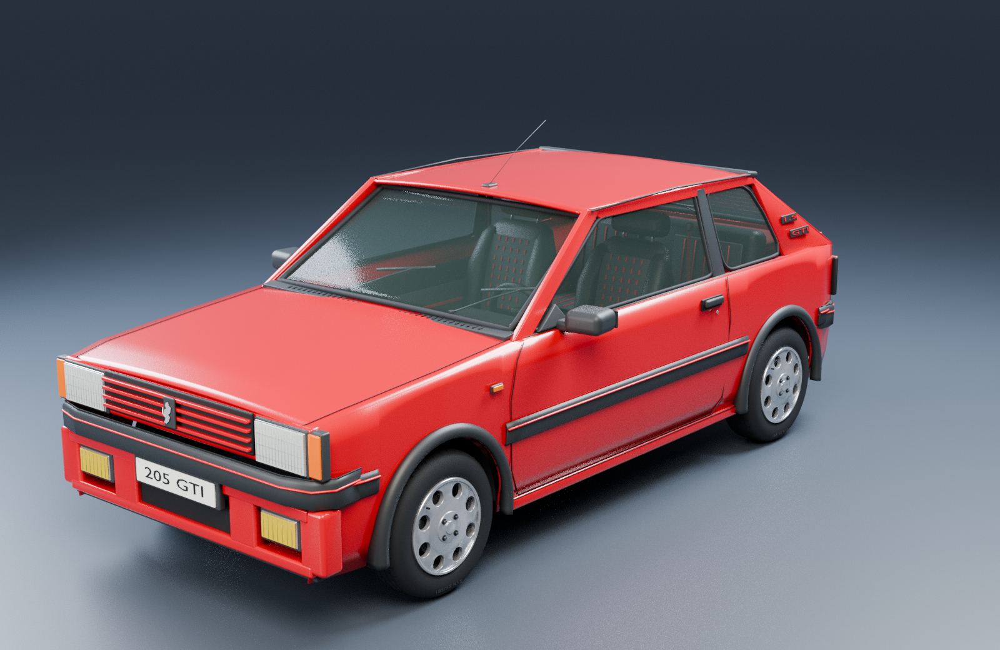
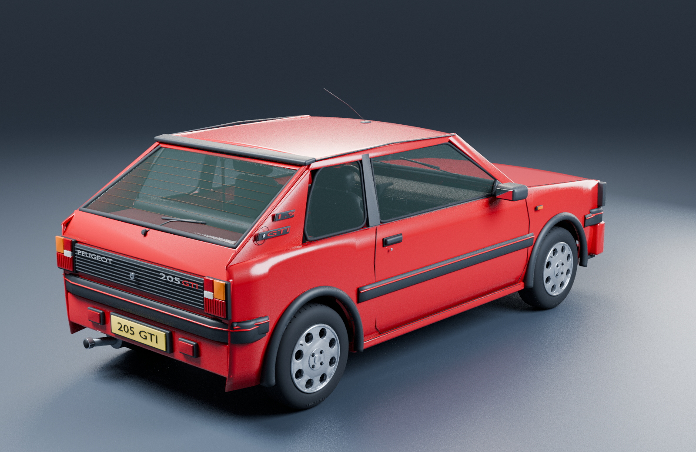
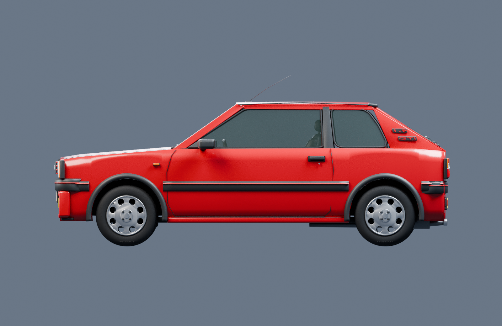

# Peugeot 205 GTI 1.9 — modèle autonome

Reconstitution visuelle procédurale originale d’une **Peugeot 205 GTI 1.9 rouge, référence 1989 / phase 1.5, conduite à gauche**. La carrosserie, les vitrages, les jantes à huit ouvertures, les pneus, les feux, les badges et l’habitacle sont construits en géométrie par les scripts de ce dossier. Les matériaux n’utilisent aucune texture image externe. Aucun modèle tiers n’a été importé et aucune photographie source n’est versionnée.

**Le modèle est livré séparément du jeu.** Il n’est ajouté ni à son catalogue, ni à sa physique, ni à son rendu. Les roues et le volant ont leurs propres pivots pour permettre une intégration ultérieure. Il s’agit d’une interprétation modélisée d’après références, pas d’un scan ni d’un modèle CAO constructeur.



## Fichiers

| Fichier | Usage |
|---|---|
| `peugeot-205-gti.blend` | Scène Blender éditable, modèle seul, organisée en groupes et pièces. |
| `peugeot-205-gti.glb` | Export glTF 2.0 binaire autonome, avec matériaux et hiérarchie. |
| `peugeot-205-gti.ferro.json.gz` | Échange géométrique destiné à une future adaptation FERRO ; triangles, matériaux et transformations. |
| `generer.py` | Générateur principal Blender et exports ; peut aussi produire les aperçus. |
| `interieur.py` | Construction de l’habitacle, des sièges, instruments et du volant. |
| `modele.json` | Repères, dimensions nominales, pivots et statistiques d’export. |
| `valide_glb.py` | Contrôle structurel et géométrique du GLB, en Python standard. |
| `valide_ferro.py` | Contrôle indépendant de l’export FERRO et comparaison avec le GLB. |
| `validation.json` | Rapport de validation du GLB livré. |
| `validation-ferro.json` | Rapport de concordance FERRO/GLB, avec empreintes SHA-256 des deux exports. |
| `apercus/` | Vues avant, arrière et profil, rendues après réimportation du **vrai GLB exporté**. |

## Ouvrir le modèle

Dans **Blender 4.3 ou ultérieur**, ouvrir `peugeot-205-gti.blend`, sélectionner `peugeot_205_gti` et ses descendants, puis cadrer avec la touche du pavé numérique `.`. Utiliser *Material Preview* pour inspecter les matériaux.

Pour vérifier l’asset d’échange dans une scène neuve : **File → Import → glTF 2.0**, puis sélectionner `peugeot-205-gti.glb`. Les matériaux sont embarqués ; il n’y a aucun fichier de texture à rechercher. La transparence et les reflets dépendent du moteur de rendu utilisé.

## Repères et dimensions

**Une unité vaut un mètre.** L’origine se situe au sol, au milieu de l’empattement.

| Repère | Avant | Haut | Gauche | Droite |
|---|---|---|---|---|
| Blender | `+X` | `+Z` | `+Y` | `−Y` |
| glTF / export FERRO / Bitume | `+X` | `+Y` | `−Z` | `+Z` |

Le changement de base Blender → glTF/FERRO est `(x, y, z) → (x, z, −y)`. Il est déjà effectué dans les exports : ne pas l’appliquer une seconde fois.

| Cote de construction | Valeur nominale |
|---|---:|
| Longueur | 3,705 m |
| Enveloppe de largeur GTI de référence FIA, hors rétroviseurs | 1,589 m |
| Hauteur de pavillon, hors antenne | 1,355 m |
| Empattement | 2,420 m |
| Rayon nominal du pneu | 0,2875 m |
| Extrémité arrière / avant dans le repère longitudinal | −1,815 m / +1,890 m |

Les dimensions nominales de caisse ne sont pas la boîte englobante de tous les détails. L’antenne augmente la hauteur et les rétroviseurs augmentent la largeur. Les sculptures des pneus s’étendent légèrement autour de leur rayon nominal.

**Groupes et pivots.** `FL`, `FR`, `RL`, `RR` signifient avant gauche, avant droite, arrière gauche, arrière droite, vus depuis le poste de conduite.

| Groupe | Parent | Pivot en glTF / FERRO : `[X, Y, Z]` | Mouvement à brancher |
|---|---|---|---|
| `peugeot_205_gti` | Aucun | `[0, 0, 0]` | Pose globale du véhicule. |
| `steer_FL` | `peugeot_205_gti` | `[1.21, 0.2875, -0.68]` | Braquage autour de l’axe local `Y`. |
| `steer_FR` | `peugeot_205_gti` | `[1.21, 0.2875, 0.68]` | Braquage autour de l’axe local `Y`. |
| `wheel_FL` | `steer_FL` | `[1.21, 0.2875, -0.68]` en position de repos | Roulement autour de l’axe local `Z`. |
| `wheel_FR` | `steer_FR` | `[1.21, 0.2875, 0.68]` en position de repos | Roulement autour de l’axe local `Z`. |
| `wheel_RL` | `peugeot_205_gti` | `[-1.21, 0.2875, -0.68]` | Roulement autour de l’axe local `Z`. |
| `wheel_RR` | `peugeot_205_gti` | `[-1.21, 0.2875, 0.68]` | Roulement autour de l’axe local `Z`. |
| `steering_wheel` | `interior` | `[0.26, 0.84, -0.34]` | Rotation autour de son axe local `Y` en glTF, `Z` en Blender. |

Les coordonnées de ce tableau sont les pivots dans le repère du modèle en position de repos. Les translations **locales** des roues avant sont nulles : leur déplacement vient de `steer_FL` et `steer_FR`.

`body`, `glazing` et `interior` regroupent les pièces fixes. Le volant possède une orientation locale inclinée : conserver cette orientation et lui composer une rotation autour de son axe local. Aucun clip d’animation n’est fourni. Le braquage, le roulement, la suspension, les collisions et la conduite restent à raccorder au système du jeu. Pour le roulement idéal, l’angle parcouru vaut la distance divisée par le rayon nominal ; le signe dépend de la convention de rotation du moteur.

## Contrat de l’export FERRO

Après décompression gzip, le JSON porte le format `bitume-procedural-mesh-1`. Il contient `groups`, `materials` et `shapes`. Il s’agit d’un format d’échange autonome ; aucun importeur n’a été ajouté au jeu.

Chaque groupe contient un `name`, un `parent` et une `matrix` à 16 nombres, **rangée colonne par colonne** (*column-major*), relative au parent. Les translations sont aux indices `12`, `13`, `14`.

La transformation monde se compose : `W(groupe) = W(parent) × matrix(groupe)`.

La racine utilise directement sa propre matrice. Le champ `pivot_world` est une **indication de contrôle pour la pose de repos**. Il ne faut ni l’ajouter à la translation de `matrix`, ni l’utiliser comme une nouvelle transformation enfant.

Chaque forme désigne son groupe et son matériau, puis fournit `centre`, `taille` et `triangles`. Un triangle est exactement `[p0, p1, p2, n0, n1, n2]`.

Chaque `p` ou `n` est un vecteur de trois nombres. Les positions sont normalisées dans le cube **[−0,5 ; +0,5]**. Les normales correspondent à ce volume normalisé, conformément au contrat des formes libres FERRO.

Pour reconstruire un sommet dans le repère local du groupe, composante par composante :

```text
p_groupe[k] = centre[k] + taille[k] × p_normalisee[k]
n_groupe = normalize(n_normalisee / taille)
p_monde = W(groupe) × [p_groupe, 1]
```

La division de la normale se fait composante par composante. Une normale monde se transforme ensuite par l’inverse transposée de la partie 3×3 de `W(groupe)`, puis se renormalise. Préserver l’ordre des trois sommets de chaque triangle.

Lors d’une future adaptation au moteur, `FRender.forme(nom, triangles)` recevra les triangles normalisés ; l’instance utilisera la vraie `taille` et la position transformée de `centre`. Les formes doivent être enregistrées avant la création du renderer. Le shader FERRO applique déjà la correction de normale par la taille : ne pas la précalculer une seconde fois dans les triangles enregistrés. Les matériaux PBR (couleur, rugosité, métal, vernis) restent à associer aux recettes FERRO lors de l’intégration.

## Reconstruire

Depuis la racine du dépôt, avec Blender accessible dans `PATH` :

```bash
cd modeles/peugeot-205-gti
blender -b --python generer.py -- --output .
```

Pour reconstruire aussi les aperçus, depuis ce même dossier :

```bash
blender -b --python generer.py -- --output . --render --samples 112 --resolution 1600
```

`generer.py` et `interieur.py` doivent rester dans le même dossier. Le script recrée la scène du processus Blender lancé et remplace les exports dans le dossier de sortie ; utiliser un autre `--output` pour conserver des retouches manuelles. Aucun téléchargement ni module Python externe n’est nécessaire.

## Vérifier

Les deux validateurs utilisent uniquement Python standard. Depuis `modeles/peugeot-205-gti` :

```bash
python3 valide_glb.py --output validation.json peugeot-205-gti.glb
python3 valide_ferro.py --output validation-ferro.json peugeot-205-gti.ferro.json.gz peugeot-205-gti.glb
```

Le code retour est `0` si les contrôles passent, `1` en cas de défaut. Le premier contrôle les buffers embarqués, les indices, les coordonnées et normales, les triangles, la hiérarchie et les pivots. Le second recompose indépendamment les matrices, dénormalise les formes et compare les deux exports globalement et pièce par pièce.

### Mesures de l’export livré

Les deux rapports sont valides, sans erreur ni avertissement.

| Mesure | Résultat |
|---|---:|
| Triangles instanciés, GLB et FERRO | 146 658 |
| Maillages distincts / matériaux / images dans le GLB | 43 / 38 / 0 |
| Groupes / formes dans l’échange FERRO | 11 / 67 |
| Triangles dégénérés détectés | 0 |
| Boîte englobante totale X × Y × Z | 3,7050 × 1,6030 × 1,9077 m |
| Écart maximal entre les AABB de chaque pièce GLB/FERRO | < 0,000001 m |

Le GLB partage certains maillages entre les quatre roues ; le nombre de formes FERRO et le nombre de maillages distincts GLB n’ont donc pas à être identiques. Les rapports constituent les mesures de référence après toute régénération. Ces contrôles portent sur l’asset, sans mesure de performances ni validation de conduite dans le jeu. Aucun jeu de LOD ou volume de collision séparé n’est fourni.

## Références de construction

- [Peugeot / Stellantis — « 10 reasons why the Peugeot 205 GTI is the greatest hot hatch ever »](https://www.media.stellantis.com/uk-en/peugeot/press/10-reasons-why-the-peugeot-205-gti-is-the-greatest-hot-hatch-ever) : empattement de 2 420 mm, jantes Speedline de 15 pouces propres à la 1.9 et éléments d’identité visuelle GTI.
- [FIA — fiche d’homologation A-5301](https://historicdb.fia.com/sites/default/files/car_attachment/1601059801/homologation_form_number_5301_group_a.pdf), page 2 : référence de caisse 205 GTI 1.6, longueur 3 705 mm, largeur 1 589 mm, empattement 2 420 mm, porte-à-faux avant 680 mm et arrière 605 mm. Cette fiche de caisse commune a servi de référence dimensionnelle ; elle ne certifie pas chaque détail de notre interprétation 1.9.
- [FIA — fiche d’homologation A-5325, 205 GTI 1.9](https://historicdb.fia.com/sites/default/files/car_attachment/1600902901/homologation_form_number_5325_group_a.pdf) : référence complémentaire spécifique à la motorisation 1.9.
- [Auto Motor und Sport — données techniques de la 205 GTI de 1990](https://www.auto-motor-und-sport.de/test/kosten-realverbrauch-peugeot-205-gti-von-1990/technische-daten/) : source secondaire pour la hauteur nominale de 1,355 m.

La largeur de 1,589 m est reprise comme enveloppe GTI de référence FIA. La hauteur de pavillon et certains détails de surface restent des choix de reconstruction visuelle. Les noms Peugeot, 205 GTI et Speedline identifient le véhicule et ses références ; ce modèle original n’est pas présenté comme un asset constructeur officiel.




